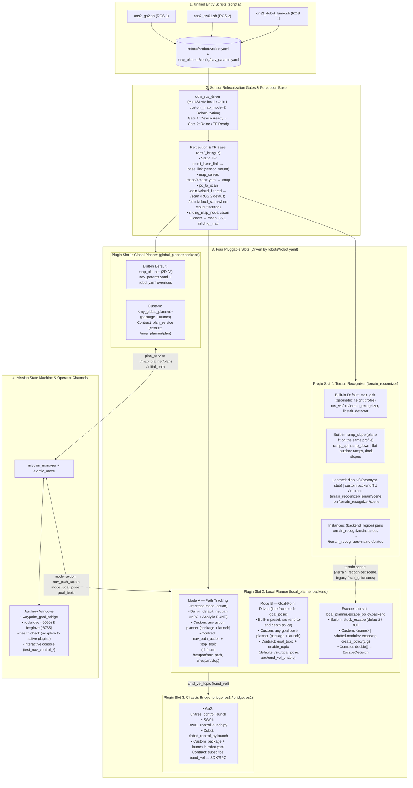
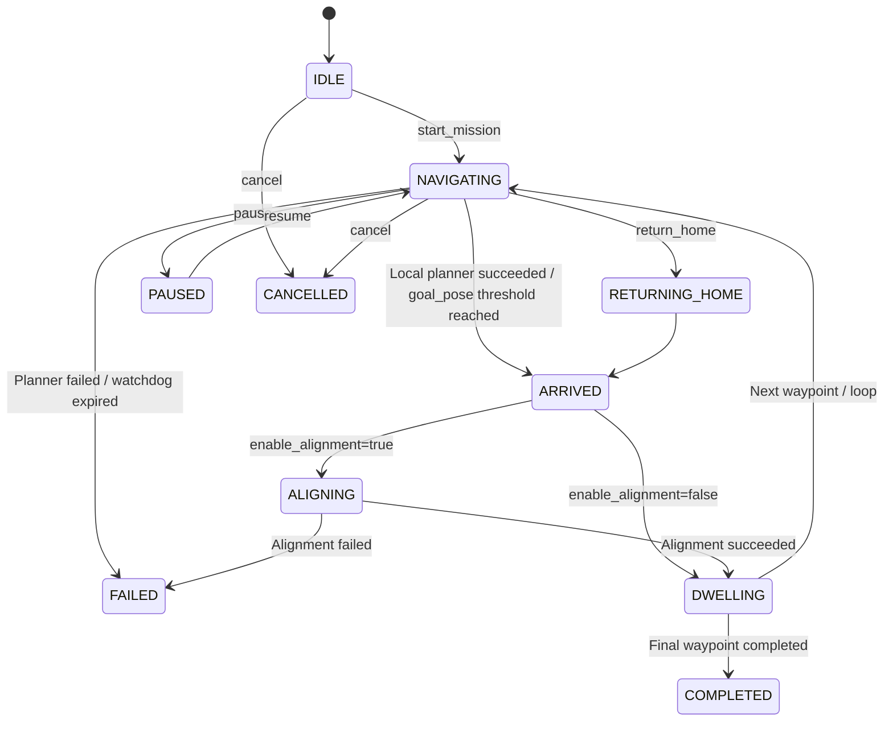

# ONS2 System Architecture

This document describes the architecture, module boundaries, runtime process topology, and pluggable interface contracts of the ONS2 navigation stack across **ROS 1 Noetic (`ros_ws/`)** and **ROS 2 Jazzy (`ros2_ws/`)**.

---

## 1. Design Goals & Principles

1. **End-to-End Inspection Navigation Loop**: Relocalization -> Multi-waypoint mission scheduling -> Global A* planning (`map_planner`) -> Local MPC + DUNE obstacle avoidance (`NeuPAN`) -> Closed-loop goal alignment (`atomic_move`) -> Return home.
2. **Robot-Agnostic Core & Single Source of Truth**: Robot-specific geometry, sensor mount TF, footprint, planner overrides, and plugin selections live exclusively in [`robots/<robot>/robot.yaml`](ROBOT_PROFILE.md).
3. **Three Pluggable Extension Slots**: Users can replace the **Global Planner** (`global_planner`), **Local Planner** (`local_planner`), or **Chassis Bridge** (`bridge`) via `robots/<robot>/robot.yaml` without modifying core C++ or launch files.
4. **Dual ROS 1 / ROS 2 Parity**: Topic, service, and action names are identical across ROS 1 (`ros_ws/`) and ROS 2 (`ros2_ws/`). Upstream NeuPAN (`NeuPAN/`) is shared directly across both runtimes.
5. **Single `/cmd_vel` Publisher Invariant**: At any instant, `/cmd_vel` is driven by at most one active controller (local planner or `atomic_move`), coordinated by explicit stop/enable handover signals from `mission_manager`.
6. **Localization Delegated to On-Device MindSLAM**: ONS2 contains no SLAM or relocalization algorithm of its own (no gmapping / cartographer / AMCL). All mapping and 6-DoF pose estimation are delegated to **MindSLAM**, the closed-source SLAM engine built into the Odin1 device; the open stack is an orchestration + planning layer built on top of its outputs (see § 5.1).

---

## 2. Layered Architecture & Plugin Slots



| Slot | Selected by (`robot.yaml`) | Default | Contract |
|---|---|---|---|
| 1. Global planner | `global_planner.backend` | `map_planner` | `nav_interfaces/PlanPath` service (`plan_service`) |
| 2. Local planner | `local_planner.backend` (+ `backends.<name>.interface.mode`) | `neupan` | `nav_path` action (mode `action`) or `goal_topic` + `enable_topic` (mode `goal_pose`) |
| 2b. Escape policy | `local_planner.escape_policy.backend` | `stuck_escape` | Python factory: `create_policy(cfg)` → `EscapePolicy.decide()` → `EscapeDecision` |
| 3. Chassis bridge | `bridge.ros1` / `bridge.ros2` | per robot | Subscribe `cmd_vel_topic`, forward to SDK/RPC |
| 4. Terrain recognizer | `terrain_recognizer.backend` (single) or `terrain_recognizer.instances` (one backend + region per instance) | `stair_gait` (Go2) / disabled elsewhere | `terrain_recognizer/TerrainScene` on `/terrain_recognizer/scene`, per-instance `TerrainObservation` on `/terrain_recognizer/<name>/status`, plus a reduced legacy `/stair_gait/status` JSON |

Slots 1–3 are wired by `scripts/lib/robot_profile.py` into both runtimes. Slot 2b is exported as the `NEUPAN_ESCAPE_POLICY` / `NEUPAN_ESCAPE_CONFIG` environment variables (`go2.launch`, `dobot.launch`, ROS 2 `bringup.launch.py` → `neupan_ros.launch.py`). Slot 4 is ROS 1 only today (`ros_ws/src/terrain_recognizer`, launched from `go2.launch`), because its reference backend consumes `/odin1/cloud_slam` directly.

---

## 3. ROS 1 vs. ROS 2 Runtime Comparison

| Dimension | ROS 1 (`ros_ws/`) | ROS 2 (`ros2_ws/`) |
|---|---|---|
| **Target OS / Distro** | Ubuntu 20.04 + ROS Noetic | Ubuntu 24.04 + ROS 2 Jazzy |
| **Entry Scripts** | `scripts/ons2_go2.sh`, `scripts/ons2_dobot_lumo.sh` | `scripts/ons2_sw01.sh` |
| **Bringup Launch** | `ons2_bringup/launch/{go2,dobot}.launch` | `ons2_bringup/launch/bringup.launch.py` |
| **Discovery** | `roscore` (`ROS_MASTER_URI`) | DDS (`ROS_DOMAIN_ID=98` across all windows) |
| **Build Tool** | `catkin_make` | `colcon build --symlink-install` |
| **Static Map Server** | `map_server` | `nav2_map_server` (configured & activated via lifecycle) |
| **NeuPAN Core** | `NeuPAN/` via `neupan_upstream_action_node.py` | `NeuPAN/` via `ros2_shim.py` + `neupan_action_node.py` |

---

## 4. Repository Layout & Package Inventory

```text
base_inspection/
├── robots/                        # Single source of truth for per-robot profiles
│   ├── _template/                 # Annotated template (robot.yaml + neupan/{config,planner}.yaml)
│   ├── go2/                       # Unitree Go2 profile & NeuPAN configs
│   ├── sw01/                      # ASTRALL SW01 profile & NeuPAN configs
│   └── dobot_lumo/                # Dobot Lumo profile & NeuPAN configs
├── NeuPAN/                        # Shared MPC + DUNE local planner core + escape_policies slot (Python, GPL-3.0)
├── ros_ws/src/                    # ROS 1 Noetic packages
│   ├── ons2_bringup/              # Profile-driven ROS 1 launch files
│   ├── nav_interfaces/            # Messages, services, and actions
│   ├── sliding_map/                   # 360-degree ego-centric virtual scan & obstacle memory
│   ├── map_planner/               # Global 2D A* planner & scan temporal filter
│   ├── neupan_ros/                # ROS 1 action server wrapper for NeuPAN
│   ├── mission_manager/           # Multi-waypoint mission state machine
│   ├── atomic_move/               # Closed-loop move / turn / align services
│   ├── unitree_control/           # Unitree Go2 SDK2 velocity bridge
│   ├── dobot_ros_control/         # Dobot Lumo RPC velocity bridge & O1L launch
│   ├── odin_vlm_terminal/         # VLM image query node
│   ├── pointcloud_saver/          # PCD map exporter
│   ├── pcd2pgm/                   # ROS 1 PCD-to-PGM converter
│   ├── fish2pinhole/              # Fisheye undistortion & cloud cropper
│   ├── stair_gait/                # Stair semantics (libstair_detector) + Go2 climbing-gait handover
│   ├── terrain_recognizer/        # Terrain-semantics SLOT: backend factory + TerrainObservation msg
│   └── yolo_ros/                  # YOLOv5 detector & 3D object query node
├── ros2_ws/src/                   # ROS 2 Jazzy packages (1:1 core parity with ros_ws)
│   ├── ons2_bringup/              # Generic profile-driven bringup.launch.py
│   ├── nav_interfaces/            # ROS 2 IDL messages, services, and actions
│   ├── sliding_map/                   # ROS 2 360-degree virtual scan & obstacle memory
│   ├── map_planner/               # ROS 2 global A* planner & cloud/scan filters
│   ├── neupan_ros/                # ROS 2 action server + ros2_shim.py
│   ├── mission_manager/           # ROS 2 mission state machine & path safety validator
│   ├── atomic_move/               # ROS 2 closed-loop alignment node
│   ├── sw01_ros_control/          # ASTRALL SW01 SDK velocity bridge
│   ├── odin_vlm_terminal/         # ROS 2 VLM query node
│   └── pointcloud_saver/          # ROS 2 PCD map exporter
├── perception/                    # Standalone edge VLM inspection & person-following package
├── scripts/                       # Unified entry scripts (ons2_*.sh) & categorized tools
│   ├── lib/                       # robot_profile.py & ons2_lib.sh
│   ├── brain/                     # ASR, TTS, LLM proxy & Hermes web launchers
│   ├── tools/                     # mission_cli.sh, point_record.py, chassis_response_test.py
│   ├── systemd/                   # SW01 UDP port redirect systemd service
│   └── map_processing/            # pcd_to_pgm.py, pgm_to_irsim_world.py, 3DGS converters
└── docs/                          # Documentation
    ├── usage/                     # 01_quick_start, 02_parameter_tuning, 03_integrate_your_robot,
    │                              #   04_custom_terrain_backend
    ├── architecture/              # ROBOT_PROFILE.md, ONS2_ARCHITECTURE.md, MODULE_DATAFLOW.md
    ├── TUNING_GUIDE.md            # Detailed parameter dictionary & troubleshooting reference
    └── ROADMAP.md                 # Terrain-recognizer & escape-policy slot roadmap
```

---

## 5. Core Modules & Runtime Behavior

### 5.1 Sensor Driver & Relocalization Gates (`odin_ros_driver`)

#### 5.1.1 Navigation Principle: MindSLAM as the Localization & Mapping Backbone

**MindSLAM** is the SLAM / relocalization engine built into the Odin1 sensing module. It runs on the device side (behind the closed-source `libmanifold_lc_sdk`); this repository ships only the open ROS driver wrapper (`odin_ros_driver` submodule, Apache-2.0). The hardware/software boundary is therefore:

| Side | Component | Responsibility |
|---|---|---|
| **Odin1 device (closed)** | MindSLAM engine + lidar / camera / IMU sensing | Real-time SLAM, relocalization against `.bin` maps, 6-DoF pose estimation, point-cloud registration |
| **Onboard computer (open, this repo)** | `odin_ros_driver` wrapper | Exposes MindSLAM outputs as ROS topics / TF / services; mode & map selection via `control_command.yaml` |
| **Onboard computer (open, this repo)** | Perception chain, global / local planners, mission layer | Obstacle memory, A* / NeuPAN / SRU planning, mission scheduling, chassis control — all consume MindSLAM's pose and clouds without re-estimating them |

MindSLAM's operating mode is selected by `custom_map_mode` in the driver's `control_command.yaml` (`0: Odometry | 1: SLAM | 2: Relocalization`). Within ONS2 it plays four roles:

1. **Sole source of global localization.** During navigation MindSLAM runs in relocalization mode (`custom_map_mode: 2`) against a prebuilt `.bin` map and publishes the TF chain `map → odom → imu` plus `/odin1/odometry`. Every downstream module — global A*, NeuPAN, `sliding_map`, `mission_manager`, `atomic_move` — trusts this pose as the robot's ground truth in the map frame.
2. **Map building (offline prior maps).** In SLAM mode (`custom_map_mode: 1`) MindSLAM produces both maps the stack navigates on: the `.bin` relocalization map (saved via the driver's `save_map` service, used by MindSLAM itself for role 1) and the registered SLAM cloud, which `pointcloud_saver` exports to `.pcd` and `pcd2pgm` / `pcd_to_pgm.py` converts into the static `.pgm/.yaml` occupancy grid served by `map_server`. See the [Map Tutorial](../map-tutorial/map-tutorial.md).
3. **Real-time perception input.** MindSLAM's registered cloud `/odin1/cloud_slam` is the raw material of the whole perception chain (§ 5.2), stair detection (`stair_gait`) and 3D planning (`octo_planner_ros1`). The stack never re-registers raw sensor data — it relies on MindSLAM having already fused it into a consistent frame.
4. **Constraint shaping the multi-floor design.** MindSLAM cannot hot-switch relocalization maps, so `floor_manager` must rewrite `control_command.yaml` (`custom_map_mode: 2`, `relocalization_map_abs_path`) and restart the driver on every floor change, then wait for TF to stabilize — a stop → rewrite → restart cycle that exists purely because of this engine limitation.

The exception is mapless mode (`scripts/ons2_sw01_mapless.sh`): MindSLAM runs in SLAM mode on a blank map with a static identity `map → odom`, Gate 2 is skipped, and the stack navigates on freshly scanned obstacles only.

#### 5.1.2 Startup Gates

- Before starting the driver (when `--mock-odin` is not set), `ons2_prepare_odin_reloc_config` in `scripts/lib/ons2_lib.sh` enforces `custom_map_mode: 2` (`0: Odometry | 1: SLAM | 2: Relocalization`), `use_host_ros_time: 1`, and sets `relocalization_map_abs_path` to `customer_file/<map>.bin`. Its optional third argument selects the Odin mode: `scripts/ons2_sw01_mapless.sh` passes `1` (SLAM), does not use a relocalization map, and skips Gate 2.
- **Gate 1** waits for `Device ready and streams activated`; **Gate 2** waits for `relocalization success` (or `odom -> map` TF on O1L) before launching downstream navigation nodes.

### 5.2 Perception Chain (`pc_to_scan` -> `scan_temporal_filter` -> `sliding_map`)
- **Cloud persistence filter (`odin_cloud_temporal_filter`, ROS 2)**: Launched by `ons2_bringup` with `cloud_filter` (`on` | `shadow` | `off`, default `on`). It consumes `/odin1/cloud_slam` + `/odin1/odometry` and publishes `/odin1/cloud_filtered`; with `on`, `pc_to_scan` reads the filtered cloud, with `shadow` the filter runs without redirecting `pc_to_scan`, and with `off` it is not launched. The ROS 1 `whole.launch` defaults `cloud_filter_mode` to `off`. Parameters: `map_planner/config/odin_cloud_filter.yaml`.
- **`pc_to_scan`**: Projects the active cloud (`/odin1/cloud_filtered` when `cloud_filter=on`, otherwise `/odin1/cloud_slam`) into `odin1_base_link` using `navigation.min_height` and `navigation.max_height` from `robots/<robot>/robot.yaml`.
- **`sliding_map`**: Compensates for the forward sensor's ~90-degree horizontal FOV by accumulating scans in an ego-centric grid (`/sliding_map` and 360-degree `/scan_360`), filtering out returns inside the robot's own footprint (`geometry.footprint` in `robot.yaml`), and decaying blind-spot cells after `cell_decay_sec` (`8.0 s`) while immediately clearing cells traversed by visible free rays.

### 5.3 Pluggable Global Planner (`global_planner`)
- **Default (`map_planner`)**: 8-connected 2D A* with hard obstacle inflation (`inflation_radius`), soft proximity cost (`obstacle_cost_safe_distance`, `obstacle_cost_weight`), line-of-sight shortcutting (`line_of_sight_safe_distance`), and Laplacian smoothing. Shared algorithm defaults live in `map_planner/config/nav_params.yaml`; per-robot overrides live in `robots/<robot>/robot.yaml`.
- **Custom Global Planner**: Selected via `global_planner.backend` in `robot.yaml` (or `--global-planner=<name>`). Must advertise `plan_service` (default `/map_planner/plan`, `nav_interfaces/srv/PlanPath`). Optional services (`/map_planner/validate_path` and `/map_planner/plan_sequence`) are skipped automatically when not advertised.

#### 5.3.1 Global Navigation Principle (`map_planner`)

The default global planner answers "which route through the building" on every plan request, using the MindSLAM-derived pose (§ 5.1) as start and the merged occupancy grid as the world model:

1. **World model merging**: the static prior `/map` (the `.pgm` converted from MindSLAM's SLAM cloud) is merged with dynamic obstacles from `/sliding_map` (the 360° ego-centric obstacle memory, § 5.2) into a single planning grid before every A* run. A coarse persistent global-memory grid additionally records LiDAR hits outside static walls (~0.2 m resolution), with start/goal exemption disks so the robot's own vicinity never self-blocks.
2. **Cost shaping**: hard obstacle inflation (`inflation_radius`) plus a soft proximity cost (`obstacle_cost_safe_distance`, `obstacle_cost_weight`) computed from a cached Chamfer distance transform, updated incrementally for dynamic cells. On multi-floor maps, a stair prior (`<map>.stairs.json`) adds a lateral-cost multiplier that keeps the route near tread centres without turning stairs into hard obstacles.
3. **Search & post-processing**: 8-connected A* over the shaped grid, then line-of-sight string-pulling simplification and Laplacian smoothing.
4. **Quality gate**: `validatePath()` rejects paths with excessive initial heading error, kink angle, or insufficient minimum clearance before they are handed to the local planner.
5. **Replanning policy**: `mission_manager` triggers replans periodically (`replan_periodic` mode) or when the active path is blocked; an install gate (`install_gate_enable`) compares each candidate against the active path and rejects regressions (`REQUIRES_ALIGNMENT`, `HEADING_WORSEN`, `NO_CHANGE`, `SIDE_LOCK`), so a noisy dynamic map cannot make the route oscillate (§ 5.5).

The 3D variant (`octo_planner_ros1`, fork) applies the same idea in an OctoMap voxel grid behind the identical `PlanPath` contract.

### 5.4 Pluggable Local Planner (`local_planner`)
Selected via `local_planner.backend` in `robot.yaml` (or `--local-planner=<name>`). Supports two interface modes via `interface.mode`, each with a built-in implementation and configurable ROS topic/action names for custom planners:
- **Mode A — Path Tracking (`interface.mode: action`)**:
  - **Built-in default (`neupan`)**: Model Predictive Control (MPC) coupled with analytical DUNE (`dune_use_analytic: true`) and SCS conic QP (`NRMP`), plus `adaptive_d_max` and a pluggable escape policy (default `stuck_escape`, see §5.4.3). Configured in `robots/<robot>/neupan/{config,planner}.yaml`.
  - **Custom action planner**: Any path-tracking local planner (launched via `package + launch` in `robot.yaml` or externally).
  - **Contract**: Tracks the global path via `nav_path_action` (default `/neupan/nav_path`) and aborts on `stop_topic` (default `/neupan/stop`).
- **Mode B — Goal-Point Driven (`interface.mode: goal_pose`)**:
  - **Built-in preset (`sru`)**: End-to-end depth policy with spatially-enhanced recurrent memory.
  - **Custom goal-pose planner**: Any goal-driven local planner (launched via `package + launch` in `robot.yaml` or externally).
  - **Contract**: Bypasses global A* planning; receives the active waypoint directly on `goal_topic` (default `/sru/goal_pose`) gated by `enable_topic` (default `/sru/cmd_vel_enable`).

#### 5.4.1 Local Obstacle-Avoidance Principle (NeuPAN)

NeuPAN answers "how to move right now" every control frame, directly against obstacle **points** rather than a grid — no costmap, no inflation, and (in the analytic configuration used here) no per-chassis neural-network training:

- **Point-robot formulation**: the robot footprint is expressed as convex-polygon inequalities around a point model, so each obstacle point from `/scan_360` becomes one collision-avoidance constraint in the optimization.
- **PAN (Proximal Alternating-minimization Network)**: the per-frame solver alternates two blocks — **DUNE** (Deep Unfolded Neural Encoder) maps the obstacle point flow into a latent distance space (`mu` / `lambda`); with `dune_use_analytic: true` this mapping is computed analytically from the robot geometry instead of a trained `ObsPointNet`. **NRMP** (Neural Regularized Motion Planner) then solves the receding-horizon MPC problem — track the global path subject to kinematics and the latent-distance collision constraints — as a differentiable conic QP (`cvxpylayers` + SCS).
- **Adaptive safety band**: `AdaptiveDMax` estimates the corridor half-width from side obstacle points and clamps the safety distance `d_max`, so the same planner behaves conservatively in narrow corridors and boldly in open space; `CurvatureSpeedGovernor` caps the reference speed by the upcoming path curvature (`sqrt(a_lat_max / kappa)`).
- **Output conditioning**: the MPC command passes an acceleration rate limiter and a `w_deadband` hysteresis gate before being published on `/cmd_vel`, with `/neupan/control_trace` exposing every intermediate decision.

The per-frame pipeline diagram is in [MODULE_DATAFLOW § 3](MODULE_DATAFLOW.md#3-neupan-per-frame-control-pipeline).

#### 5.4.2 Stuck-Escape Principle (`stuck_escape`)

When the optimizer keeps commanding motion but the robot makes no progress (blocked by an unseen obstacle, a local minimum, or a too-narrow passage), a platform-independent state machine — `StuckEscapePolicy` in `NeuPAN/neupan/escape_policies/stuck_escape.py`, shared verbatim by the real robot node and the simulation benchmark — takes over `/cmd_vel` with a **back up + turn + replan** maneuver:

1. **Stall detection**: the recommended `progress` criterion measures arc-length advance along the reference path over a 1 s window (`< 0.05 m` = stalled), which separates rocking-in-place from slow-but-real progress; a legacy `displacement` criterion and an oscillation detector are also available.
2. **Trigger gates**: a front-cone obstacle check plus a frame counter (`+1` when stalled and blocked, `-2` decay otherwise, escape at `trigger_frames`) prevent false triggers; corridor and clearing guards hold the counter when the robot is legitimately squeezing through a narrow corridor or the obstacle is moving away.
3. **Escape maneuver**: reverse at `back_speed`, then rotate toward the side with larger 360° clearance — full rotation requires `rotate_clearance_m`; otherwise a bounded-angle or open-space rotation gate applies. Identical consecutive escapes flip direction after `limit_cycle_consecutive_n` attempts.
4. **Exit & recovery**: escape ends when front clearance exceeds `exit_obs_distance` or after `duration_sec`; the policy then requests a fresh global plan (`/neupan/replan`) and applies a post-escape grace period with relaxed tracking weights so the planner re-converges smoothly instead of immediately re-entering escape.

The full gate-by-gate parameter table is in [MODULE_DATAFLOW § 4](MODULE_DATAFLOW.md#4-escapepolicydecide-gate-sequence); all thresholds are tunable per robot in `robots/<robot>/neupan/config.yaml`.

#### 5.4.3 Escape Policy Slot (`local_planner.escape_policy`)

`StuckEscapePolicy` is the **reference implementation of a slot**, not a hard-wired behavior. The MPC core (PAN/NRMP/DUNE, `adaptive_d_max`, curvature governor) is never replaced; only the decision that overrides `/cmd_vel` when the local planner stalls is swappable:

```yaml
local_planner:
  backend: neupan
  escape_policy:
    backend: stuck_escape        # stuck_escape | null | <name> | <dotted.module>
    # config: neupan/escape_policy.yaml   # optional per-robot override file
```

- **Selection precedence** (`neupan_ros.py`): `NEUPAN_ESCAPE_POLICY` (exported from `robot.yaml` by `robot_profile.py` / both launch stacks) → `escape_policy.backend` in `robots/<robot>/neupan/config.yaml` → `stuck_escape`.
- **Contract** (`NeuPAN/neupan/escape_policies/base.py`): the only abstract method is `decide(now, robot_state, obstacle_points, ...) → EscapeDecision` (`cmd`, `entered`, `exited`, `request_replan`, `grace_scales`, `info`). Inert defaults exist for every other hook and for the state attributes `neupan_ros.py` reads (trace, recovery shadow, logs), so a custom policy really can be "one `decide()`".
- **Registration**: `register_escape_policy(name, factory)` at import time, or point the slot at a dotted module exposing `create_policy(cfg)` — no change to ONS2 source needed.
- **Parameter layering**: `NEUPAN_ESCAPE_CONFIG` (from `escape_policy.config`) is loaded over the shared `stuck_escape:` block, which itself stays the default source, so an untouched robot keeps its exact deployed tuning.
- **Compatibility**: `neupan.util.stuck_escape` remains as a re-export shim, so the simulation benchmark and older site scripts import the same classes.
- **Terrain coupling**: the policy opts into terrain awareness with `stair_suppress_enable: true`, which makes `neupan_ros.py` subscribe to `/stair_gait/status` (JSON verdict) and call `note_terrain(...)`; that verdict is produced by the terrain-recognizer slot (§5.6).

Regression tests: `NeuPAN/example/sw01_bench/test_escape_policy_slot.py` (slot contract + slot↔direct parity + shim identity), `test_stuck_escape.py`, `test_path_block_grace.py`.

### 5.5 Mission State Machine (`mission_manager`) & Alignment (`atomic_move`)



- **Periodic replan install gate (`install_gate_enable`, default `true` on both ROS 1 `mission_manager.launch` and ROS 2 `mission_manager.launch.py`)**: before a periodic replan result replaces the active path, `mission_manager` checks the candidate and rejects it with `REQUIRES_ALIGNMENT`, `HEADING_WORSEN`, `NO_CHANGE` or `SIDE_LOCK`. `install_gate_shadow` (default `false`) only logs the decision without blocking. The path-validity watchdog (`path_block_replan_enable`, default `true`) depends on this gate's blocked detection.
- Upon reaching a waypoint (`ARRIVED`), `mission_manager` publishes `stop_topic` (`/neupan/stop`) and disables `enable_topic` (`/sru/cmd_vel_enable`) to guarantee exclusive `/cmd_vel` ownership before invoking `atomic_move` (`/atomic_move/align`) for closed-loop final yaw alignment.

### 5.6 Terrain Recognizer (`terrain_recognizer`)

Everything in §5.1–§5.5 treats the floor as a plane whose only interesting property is whether a cell is occupied. Stairs, ramps and landings break that assumption, so ONS2 isolates "what is the ground ahead?" behind its own slot. The node owns the ROS plumbing; the model is a backend:

```yaml
terrain_recognizer:            # top-level in robots/<robot>/robot.yaml
  backend: stair_gait          # single-instance shorthand: stair_gait | ramp_slope | dino_v3 | <custom>
  # config: terrain_recognizer/stair_gait.yaml   # optional per-robot override
  # instances: terrain_recognizer/instances.yaml # multi-terrain: one (backend, region) per area
```

- **Node** (`ros_ws/src/terrain_recognizer`): subscribes `cloud_topic` (`/odin1/cloud_slam`), transforms into `base_frame`, ticks every instance at `detect_rate_hz`, crops the cloud to that instance's region, debounces each verdict with `confirm_frames` identical ones, then publishes.
- **One region per backend, several regions per node.** A single model can only describe the ground it was pointed at, while real sites put stairs ahead of the robot and a ramp beside it in the same frame. `terrain_recognizer.instances` therefore declares named `(backend, region)` pairs; `backend` stays valid as the one-instance shorthand and is also the default backend for instances that omit their own. Backend *parameters* remain node-global, so instances differ by region, not by tuning.
- **Contract**: `terrain_recognizer/TerrainObservation` per instance (latched) — `type` (`flat`, `stair_up`, `stair_down`, `ramp_*`, `landing`, `unknown`), `confidence`, measured geometry (`steps` for stairs; `rise_m` / `span_m` as tread height or whole-slope height change, over the fitted extent), `valid`, `geometry` (`PolygonStamped`, the analyzed region, clipped to the instance region), `backend`, `instance`, and `legacy_state` (`flat|up|down|unknown`). Single-instance mode keeps the historical topic `/terrain_recognizer/status`; with instances each one publishes `/terrain_recognizer/<name>/status`. `terrain_recognizer/TerrainScene` on `/terrain_recognizer/scene` carries every instance's verdict for the same frame and is what a consumer asking "what is around me" subscribes to.
- **Legacy reducer**: `/stair_gait/status` remains one latched JSON verdict, because NeuPAN's escape terrain gate (§5.4.3) can only act on one. It is reduced from the instances whose `legacy` flag is on *and* whose region really overlaps the forward corridor (`legacy_corridor_half_width`, `0.6 m` — at least half of the narrower of region and corridor, so clipping the corridor edge is not enough); a staircase outranks a flat reading and ties break on confidence, so a side-facing instance can never suppress escape.
- **Backends**: `stair_gait` wraps `libstair_detector` from the `stair_gait` package — a ROS-free height-profile analyzer along +x in `base_link` (`roi_*`, `bin_m`, `min/max_rise_m`, `min_steps`). It is geometry only, needs no camera or GPU, and is what Go2 runs. `ramp_slope` reuses the same profile but fits a straight line instead of counting treads, so it reports `ramp_up` / `ramp_down` / `flat` for continuous slopes (dock levellers, garage ramps, apron-to-yard transitions); treads fail its residual gate, so the two backends divide the vocabulary instead of competing, and a ramp verdict deliberately carries `legacy_state: flat` so it never holds the escape gate. Its keys are prefixed `ramp_slope/`, which also lets it be loaded unconditionally for instances. `dino_v3` is an interface-complete stub (parameters defined, no verdict emitted) reserved for a learned encoder; a site model is a new translation unit registered with `registerTerrainBackend(name, factory)` plus one CMake entry — the full walkthrough (contract table, compiling skeleton, build/config wiring, offline tests) is [04 · Add a Custom Terrain Recognizer](../usage/04_custom_terrain_backend.md).
- **Package split**: the detector moved into `libstair_detector.so` (exported via `catkin_package(LIBRARIES ...)`), and `unitree_sdk2` became optional in `stair_gait/CMakeLists.txt`. Consumers can therefore link the geometry without the quadruped SDK, while `stair_gait_node` (climbing-gait handover, `enable_actuation: false` by default) still builds wherever the SDK is installed.
- **Scope**: detection and actuation are deliberately separate — `terrain_recognizer` never calls a gait API. Today the node is wired into the ROS 1 Go2 bringup (`go2.launch` → `terrain_recognizer.backend`); robots without the key launch nothing, which is the opt-out.

The roadmap for learned backends and terrain-aware planning is tracked in [docs/ROADMAP.md](../ROADMAP.md).
