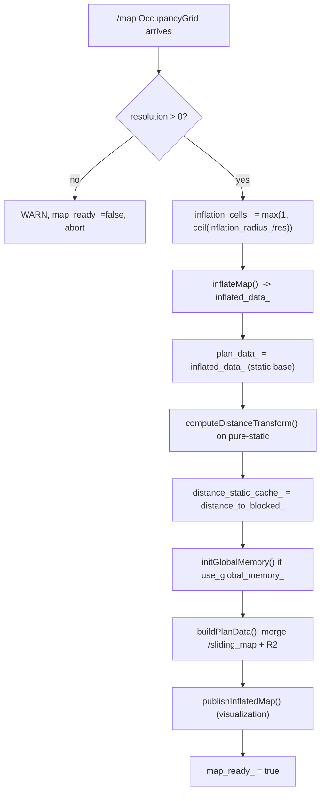

# Restricted-Area (No-Go) Model

> Standalone spec for the "禁行区域" (restricted / no-go region) that the global
> planner derives when a **new map is loaded**. This region is currently computed
> inside the `map_planner` node. This document isolates it as a self-contained
> module so it can be **decoupled and optimized independently** of A\* search,
> smoothing, and mission logic.

- **Scope**: everything that turns a raw `nav_msgs/OccupancyGrid` into the
  occupancy + clearance data the planner actually treats as impassable or
  penalized.
- **Out of scope**: A\* search, string-pulling simplification, Laplacian
  smoothing, path-quality scoring (covered in *Global Planning*).
- **Primary sources** (ROS 2 workspace):
  [`map_planner.cpp`](file:///home/jay/workspace/robotics/odin1/Odin-Nav-Stack2/ros2_ws/src/map_planner/src/map_planner.cpp),
  [`map_planner.h`](file:///home/jay/workspace/robotics/odin1/Odin-Nav-Stack2/ros2_ws/src/map_planner/include/map_planner.h),
  [`nav_params.yaml`](file:///home/jay/workspace/robotics/odin1/Odin-Nav-Stack2/ros2_ws/src/map_planner/config/nav_params.yaml).

---

## 1. Definitions

| Term | Meaning in this stack |
| --- | --- |
| **Restricted / no-go area (禁行区域)** | The set of cells the planner must not route through. Union of four layers: lethal map obstacles, their inflation buffer, UNKNOWN cells, and merged dynamic/persistent obstacles. |
| **Lethal cell** | Grid value `== 100` after processing. `isFree()` is false; A\* cannot expand into it. |
| **Obstacle seed** | A raw cell with `value >= obstacle_threshold_` and `>= 0` that generates an inflation disc. |
| **UNKNOWN** | Grid value `< 0` (usually `-1`). Treated as **not free** (conservative no-go), but does **not** seed inflation. |
| **Clearance band** | Non-lethal ring around blocked cells where `distance_to_blocked_ < safe_distance`; raises A\* edge cost but is still traversable. |
| **`plan_data_`** | The single merged grid the planner reads. **This is the canonical restricted-area representation.** |

Cell value convention (ROS `OccupancyGrid`, `int8`): `-1` unknown, `0` free,
`100` lethal. `obstacle_threshold_` (default `50`) separates "free-ish" from
"occupied" for seeding.

---

## 2. Data structures (module state to extract)

All owned today by `MapPlanner` — see [`map_planner.h#L133-L166`](file:///home/jay/workspace/robotics/odin1/Odin-Nav-Stack2/ros2_ws/src/map_planner/include/map_planner.h#L133-L166):

| Buffer | Type | Role |
| --- | --- | --- |
| `map_` | `OccupancyGrid` | Raw static map (reference only). |
| `inflated_data_` | `vector<int8_t>` | Static base = map + inflation. Rebuilt only on new `/map`. |
| `plan_data_` | `vector<int8_t>` | `inflated_data_` ⊕ dynamic ⊕ global memory. What A\* reads. |
| `distance_to_blocked_` | `vector<float>` | Metres to nearest blocked cell (Chamfer). Feeds soft cost + clearance checks. |
| `distance_static_cache_` | `vector<float>` | Pure-static distance map, snapshot before any dynamic merge. |
| `dynamic_touched_` | `vector<int>` | Cells flipped lethal this rebuild — seeds for incremental distance update. |
| `global_memory_` (R2) | `vector<int8_t>` | Coarse persistent obstacle hints (optional). |

Key accessors that define the model's semantics:
[`toIndex()`](file:///home/jay/workspace/robotics/odin1/Odin-Nav-Stack2/ros2_ws/src/map_planner/include/map_planner.h#L76-L78),
[`isFree()`](file:///home/jay/workspace/robotics/odin1/Odin-Nav-Stack2/ros2_ws/src/map_planner/src/map_planner.cpp#L1254-L1264),
[`cellHasClearance()`](file:///home/jay/workspace/robotics/odin1/Odin-Nav-Stack2/ros2_ws/src/map_planner/src/map_planner.cpp#L1266-L1271).

---

## 3. Map-load pipeline (the calculation logic)

Entry point: [`mapCallback()`](file:///home/jay/workspace/robotics/odin1/Odin-Nav-Stack2/ros2_ws/src/map_planner/src/map_planner.cpp#L133-L163).
On every new `/map`:



### 3.1 Static inflation — `inflateMap()`

[`map_planner.cpp#L1208-L1232`](file:///home/jay/workspace/robotics/odin1/Odin-Nav-Stack2/ros2_ws/src/map_planner/src/map_planner.cpp#L1208-L1232)

1. `inflated_data_ = map_.data` (copy). UNKNOWN (`-1`) and free values are carried over verbatim.
2. For every cell that is an **obstacle seed** (`value >= obstacle_threshold_ && value >= 0`):
   scan a square of `±inflation_cells_`, and for each neighbour whose **Euclidean**
   distance `hypot(dx,dy) * res <= inflation_radius_`, write `100` (lethal).
3. Result is swapped into `inflated_data_`.

Properties worth pinning in tests:
- Disc shape (not square) thanks to the `hypot` guard.
- Only real obstacles seed inflation; UNKNOWN cells never expand, only self-block.
- `inflation_cells_ = max(1, ceil(inflation_radius_/res))`, so a sub-resolution
  radius still yields at least a 1-cell buffer.
- Cost is **O(W·H·r²)** brute force — see optimization §6.1.

### 3.2 Static distance transform (clearance band)

[`computeDistanceTransform()`](file:///home/jay/workspace/robotics/odin1/Odin-Nav-Stack2/ros2_ws/src/map_planner/src/map_planner.cpp#L1062-L1115)

- Seeds `0.0` for every `!isFree()` cell (lethal **and** UNKNOWN), `INF` otherwise.
- Two-pass **Chamfer 1–√2** scan (forward NW/N/NE/W, backward SE/S/SW/E) →
  approximate metres-to-blocked in `distance_to_blocked_`.
- Snapshotted into `distance_static_cache_` before any dynamic overlay so the
  static field is computed **once per map**, not per frame.

This field is what makes a *soft* restricted area:
[`cellCostMultiplier()`](file:///home/jay/workspace/robotics/odin1/Odin-Nav-Stack2/ros2_ws/src/map_planner/src/map_planner.cpp#L1117-L1128)
scales A\* edge cost linearly from `1+obstacle_cost_weight_` at `d=0` down to
`1.0` at `d=obstacle_cost_safe_distance_m_`.

### 3.3 Dynamic merge — `buildPlanData()` / `inject_sliding_map()`

[`map_planner.cpp#L177-L319`](file:///home/jay/workspace/robotics/odin1/Odin-Nav-Stack2/ros2_ws/src/map_planner/src/map_planner.cpp#L177-L319)

Called on new `/map`, on every `/sliding_map`, and periodically via the
visualization timer. Logic:

1. Reset `plan_data_ = inflated_data_`, clear `dynamic_touched_` / `dynamic_map_error_`.
2. **Freshness/validity gate** — reject if the sliding map is missing
   (`DYNAMIC_MAP_UNAVAILABLE`), too old / future-dated
   (`DYNAMIC_MAP_STALE`, `sliding_map_max_age_sec_`), or TF lookup fails
   (`DYNAMIC_MAP_TF_UNAVAILABLE`). On reject the region falls back to the static
   restricted area only.
3. **Occupy pass**: for each sliding-map cell `== 100`, transform its centre to
   the map frame (yaw+translation from TF), map to `mx,my`, and stamp the same
   `inflation_radius_` disc to `100` in `plan_data_`; newly-converted cells are
   pushed to `dynamic_touched_`. If global memory is on and the underlying static
   cell is free, also `stampGlobalMemory()`.
4. **Free-clear pass**: for each sliding-map cell `== 0`, if the corresponding
   `plan_data_` cell is UNKNOWN (`< 0`), set it to free (`0`). Fresh sensor-free
   space therefore *shrinks* the no-go region — but never overrides lethal (`100`).
5. **Global memory merge** (`mergeGlobalMemory()`, §3.4) when enabled and non-empty.
6. **Distance refresh**: restore `distance_to_blocked_ = distance_static_cache_`,
   then `computeLocalDistanceTransform(dynamic_touched_)` — a bounded BFS from the
   newly lethal cells only (range `obstacle_cost_safe_distance_m_ + inflation_radius_ + 1`),
   avoiding a full recompute. See
   [`map_planner.cpp#L1154-L1206`](file:///home/jay/workspace/robotics/odin1/Odin-Nav-Stack2/ros2_ws/src/map_planner/src/map_planner.cpp#L1154-L1206).

### 3.4 Persistent coarse memory (R2, optional)

[`initGlobalMemory()`](file:///home/jay/workspace/robotics/odin1/Odin-Nav-Stack2/ros2_ws/src/map_planner/src/map_planner.cpp#L323-L338)
/
[`mergeGlobalMemory()`](file:///home/jay/workspace/robotics/odin1/Odin-Nav-Stack2/ros2_ws/src/map_planner/src/map_planner.cpp#L351-L398)

- Low-resolution grid (`global_memory_res_`) persists obstacle hints seen via the
  sliding map even after they leave the live sensor window.
- On merge each R2-occupied cell inflates `global_memory_inflation_radius_` into
  `plan_data_`, **except** within an exempt radius of the current start/goal
  (`global_memory_exempt_radius_m_`, defaulting to `inflation_radius_ + 0.3`) so
  the robot is never walled in by stale hints.

---

## 4. Restricted-area decision rule (single source of truth)

The planner's *only* question to the model is "can I be here / how costly is it":

```
isFree(cell) := 0 <= plan_data_[cell] < obstacle_threshold_
lethal(cell) := plan_data_[cell] == 100
unknown(cell):= plan_data_[cell] < 0        // isFree() == false → restricted
clearance(cell) >= d := isFree(cell) && distance_to_blocked_[cell] >= d
soft_cost(cell) := 1 + obstacle_cost_weight_ *
                       max(0, (safe_dist - distance_to_blocked_)/safe_dist)
```

A cell is effectively **no-go** iff `!isFree(cell)` (lethal OR unknown) **or** it
fails the minimum-clearance checks used by line-of-sight and validation
(`path_min_clear_m_`, `line_of_sight_safe_distance_m_`).

---

## 5. Parameters (defaults)

From
[`nav_params.yaml#L15-L38`](file:///home/jay/workspace/robotics/odin1/Odin-Nav-Stack2/ros2_ws/src/map_planner/config/nav_params.yaml#L15-L38);
per-robot overrides live in `robots/<robot>/robot.yaml`. In-code fallbacks are in
[`map_planner.h#L142-L166`](file:///home/jay/workspace/robotics/odin1/Odin-Nav-Stack2/ros2_ws/src/map_planner/include/map_planner.h#L142-L166).

| Param | YAML | Default (yaml / code) | Effect on no-go region |
| --- | --- | --- | --- |
| `obstacle_threshold` | `obstacle_threshold_` | `50` / `50` | Cell occupancy cut-off for seeds & `isFree`. |
| `inflation_radius` | `inflation_radius_` | `0.35` / `0.25` m | Hard buffer radius (lethal ring). |
| — | `inflation_cells_` | derived | `ceil(inflation_radius_/res)` (≥1). |
| `obstacle_cost_safe_distance` | `obstacle_cost_safe_distance_m_` | `0.80` / `0.5` m | Soft clearance band width. |
| `obstacle_cost_weight` | `obstacle_cost_weight_` | `8.0` / `3.0` | A\* cost bump inside band. |
| `line_of_sight_safe_distance` | `line_of_sight_safe_distance_m_` | `0.35` / `0.25` m | Min clearance for shortcuts. |
| `path_min_clear_m` | `path_min_clear_m_` | `0.10` m | Min clearance for validation. |
| `sliding_map_max_age_sec` | `sliding_map_max_age_sec_` | `2.0` s | Staleness cut-off for dynamic layer. |
| `use_global_memory` | `use_global_memory_` | `false` | Enable R2 persistent layer. |
| `global_memory_res` | `global_memory_res_` | `0.20` m | R2 grid resolution. |
| `global_memory_inflation_radius` | `global_memory_inflation_radius_` | `0.35` m | R2 buffer radius. |
| `global_memory_exempt_radius_m` | `global_memory_exempt_radius_m_` | `0.0` | Start/goal no-block radius for R2. |

> Note the **yaml vs code default mismatch** on `inflation_radius` and the cost
> params. The YAML (and per-robot override) is authoritative at runtime; the code
> default is only a fallback. Keep these in sync when decoupling.

---

## 6. Decoupling & independent optimization

### 6.1 Current cost hot-spots

- **Inflation is brute-force O(W·H·r²)** over the whole map on every new `/map`
  (`inflateMap`) and per-occupied-cell over the sliding window (dynamic pass).
- Distance transform is recomputed fully for static (`computeDistanceTransform`)
  and incrementally for dynamic (`computeLocalDistanceTransform`) — already a good
  split, but static seeds from **both** lethal and unknown.
- Dynamic merge does a full re-copy `plan_data_ = inflated_data_` each cycle.

### 6.2 Suggested module boundary

Extract a pure-C++ `RestrictedAreaModel` (no rclcpp/tf2 dependency, mirroring the
existing header-only `map_planner_quality` / `map_planner_safety` convention) with
a narrow surface:

```
class RestrictedAreaModel {
  void loadStatic(const GridInfo&, const vector<int8_t>& raw);   // inflation + static DT
  void overlayDynamic(const GridInfo& dyn, const SE2& map_from_dyn); // occupy + free-clear
  void overlayPersistent(...);                                    // R2 merge
  bool   isFree(int idx) const;
  bool   clearanceAtLeast(int idx, double m) const;
  double costMultiplier(int idx) const;
  const vector<int8_t>& lethalGrid() const;   // = plan_data_
  const vector<float>&  distanceField() const;
};
```

Benefits: TF/freshness gates stay in the ROS layer; the geometry kernel becomes
unit-testable and swappable.

### 6.3 Optimizations to prototype independently

1. **DT-based inflation**: replace nested loops with a distance-transform on the
   raw seed grid and threshold `dist <= inflation_radius` — O(W·H) instead of O(W·H·r²).
   Separable (row then column) min-filters or a two-pass Chamfer give the same disc
   within one cell.
2. **Incremental static rebuild**: when only a map patch changes (map editing,
   partial updates), re-inflate only the affected bounding box instead of the
   whole grid.
3. **LUT for the disc**: precompute the `(dx,dy)` offset list for a given
   `inflation_cells_` once, reuse in static + dynamic + R2 passes (all three
   currently duplicate the same loop).
4. **Separate "unknown policy"**: today UNKNOWN is hard no-go. A config flag to
   treat unknown as *costly but traversable* (for exploration) belongs in the model.
5. **Multi-resolution**: for large maps, keep inflation/DT at coarse res for cost
   and only refine near start/goal.

### 6.4 Regression guards before refactoring

Lock current behaviour with golden tests:
- disc geometry (corner cells excluded by `hypot`), `r < res` still yields ≥1 buffer;
- unknown does not seed inflation but is no-go;
- free-clear never demotes lethal `100`;
- staleness / TF-failure fallback to static-only;
- R2 exempt radius keeps start/goal free;
- incremental dynamic DT equals a from-scratch recompute on the same `plan_data_`.

---

## 7. Related modules

- **Sliding map** (`/sliding_map` publisher) produces the dynamic occupancy layer
  this model consumes.
- **Mission manager** triggers replanning; each plan re-reads `plan_data_`.
- **A\* planner / smoothing / validation** are downstream consumers of
  `isFree`, `cellHasClearance`, and `cellCostMultiplier`.

*This document intentionally isolates the map→no-go computation so it can evolve
(§6) without touching the search or control layers.*

---

## 8. Simulator parity — hand-painted keep-out (增禁行)

The multi-floor mesh-nav simulator (`docs/multifloor/sim/mesh_nav.template.html`)
is a parallel implementation of the same model, and it exposed the exact
asymmetry this section guards against. It is documented here because the fix and
the guard belong to the no-go model, not to the planner internals.

### 8.1 The gap (before)

Physical walls get a footprint band from `inflate()` (a flat XY disc of radius
`infR` around each OCC face), so the global route can never hug them. A
hand-painted keep-out, however, was only a **single `INFL` voxel per click**
(`blockCell` → `state.added`), and the global `traversable` rejected it at that
exact cell only. Consequences:

- The global centre line was free to run one cell clear of the patch; only the
  **local** layer (`localNoGoPts`, `lateralObstacles`, the rollout height band)
  actually dodged it — `probe_nogo.py` even relied on this via `NOREPLAN`.
- The painted voxel sat on whichever layer the click found FREE, not the floor's
  **support** layer the dog travels on, so a same-XY route cell was never blocked.
- Post-A\* `smoothLeg` re-checked points against `walkable` (which accepts the
  FREE band cells) and slid the smoothed line back over the patch.

### 8.2 The fix

`keepOutBand(m)` builds the missing band and is consulted by every consumer that
decides "can the route use this cell":

- dilates each painted cell by `round(infR/res)` cells (metric, so
  resolution-independent), and
- fills the **whole XY column across all `z`** (a keep-out is a floor *region*,
  not one voxel).

It is wired into:

1. `traversable()` in `planPathCore` — refuses band cells when `bandSoft === 0`
   (so the A\* voxel expansion, `snap`, and `chordOK` all inherit it);
2. `smoothLeg().cellOK` — the smoothing pass can no longer slide a point back
   into the band (`walkable` alone was too permissive here);
3. soft-band parity — returns an all-zero mask when `state.bandSoft > 0`, exactly
   mirroring `localNoGoPts()` returning `[]`, so a soft keep-out crosses in both
   layers.

The cache is keyed by `added.size / erased.size / inf / res / bandSoft` and reset
via `m._ko = null` in `blockCell` / `eraseCell` (alongside `_span` / `_edge`).
Operator-erased cells are skipped, matching `eraseCell`'s override.

### 8.3 Verification

`probe_nogo.py` (headless Chrome CDP):

- 3 original movement cases unchanged (hard ON `0.36` m, hard OFF `0.355` m
  parity, soft control crosses `0.007` m);
- a new **`replan`** case paints one route cell, forces a fresh global replan
  (`__MESH.replanRoute`, dog-independent) and asserts the **route centre line
  itself** clears the patch. Now `routeGap = 0.318 m` (was `0.001`); `dbgRoute`
  confirms both the raw A\* and the smoothed polyline clear it.

`__MESH.koInfo()` / `__MESH.dbgRoute(i,j,k)` remain as probe doors to inspect the
band and locate any future keep-out leak per stage.

### 8.4 Still open (deliberately)

- The automatic **wall** inflation band is still intentionally **not** fed to the
  local layer (global gates walls by corridor *width* and legitimately threads a
  narrow passage beside them); only operator-painted cells are hard locally.
- On stair-decoupled legs the macro centre-line edge is drawn directly; a keep-out
  painted on a flight column would need the same column rule applied in
  `offerMacro`/`coreBlocked`, which is out of scope for the flat-floor case.
  (Placing such a keep-out is now possible — see §8.5 — the global stair crossing
  simply still rides the centre-line past it.)

### 8.5 Keep-out on stairs, ramps and landings (placement extension)

**Symptom.** An operator painted a 禁行区 on the intermediate **landing between
two flights** and saw no red marker, and 规划 re-ran an unchanged route. Only
cells already gridded as flat floor accepted a keep-out.

**Root cause.** Placement was gated on *gridded floor* semantics, not
*standable* semantics:

- `blockCell()` hard-required `data === FREE`;
- the block click and its ring-2 fallback `nearestCellOfKind(p,'free',2)` only
  matched `data === FREE && support(...)`.

A stair tread, ramp slope and the landing plate are voxelized as an **occupied
surface stamp** (`data === OCC` with the `surfaceCell` flag) — exactly what
`traversable` accepts for stairs (`v === OCC && m.surfaceCell(...)`). They are
never `FREE`, so both the direct cell and the snap were rejected, `state.added`
stayed empty, and nothing downstream changed.

**Fix (placement only).** A keep-out is now brushable on any *standable* cell:

- new `canPaintBlock(m,i,j,k)` accepts `FREE && support` **or** `OCC &&
  surfaceCell`; it drives `blockCell`, the click `ok` test and `nearestCellOfKind`;
- a `FREE` floor cell still flips to `INFL` (band machinery unchanged), but a
  surface cell **keeps its `OCC` stamp** — overwriting it with `INFL` would open a
  hole in the flight's own surface and can disconnect the stair. The keep-out is
  carried purely by `state.added`, which `keepOutBand`, `localNoGoPts` and the pgm
  export all already read;
- `makePlanes` gained a dedicated `painted` pass that draws every `state.added`
  cell whose `data !== INFL` as a red quad, bypassing the flake / cap-width /
  patch-size heuristics that cull stair-surface cells (they are tuned for the
  flat-floor inflation band, so a lone tread keep-out never survived them);
- `eraseCell` now lifts a surface keep-out via the `erased` set without touching
  its `OCC` data.

**Verification.** `probe_nogo.py` is now **5/5**: the 4 flat-ground cases are
unchanged, plus a `single,stair` case that finds an `OCC+surfaceCell` tread,
`blockCell`s it, and asserts the surface stays `OCC` (`surfaceKeptOCC`), the cell
enters `state.added`, and the footprint band builds (`bandCells = 481`).

**Limitation (unchanged).** This is placement + local + flat-global only. On a
stair-decoupled leg the macro centre-line is still emitted verbatim, so a keep-out
on a flight/landing does not yet reroute the *global* stair crossing (§8.4).

### 8.6 Operator controls — auto band switch & clear-all

Two UI controls were added to the simulator toolbar for the two kinds of 禁行区:

- **「自动禁行带」 checkbox (`#autoNoGo`, default ON)** — master switch for the
  *auto-computed* wall-clearance band. `buildMap` grew a 5th `autoNoGo` arg; when
  false the inflation radius collapses (`rxy = 0`) so the `FREE → INFL` wall
  stamping block is skipped entirely. Walls stay solid `OCC` (still impassable);
  only the derived clearance band disappears, leaving hand-painted keep-outs.
  `m.infR` and `state.inf` are **kept** at the real radius, so dynamic-post
  clearance and the painted footprint (`keepOutBand`) are unaffected. Toggling
  rebuilds via the same `loadModel(..., 'reload')` path as the 膨胀 selector.
- **「清禁行区」 button (`#clearNoGo`)** — wipes **all** manual edits
  (`state.added` *and* `state.erased`) and rebuilds from raw geometry + the
  current inflation. `loadModel` normally re-restores a saved record, which would
  undo the wipe, so the button sets a one-shot `state._skipSaveRestore` flag that
  suppresses that restore for the rebuild.

**Verification.** `probe_autonogo.py`: auto-INFL cells (not in `state.added`) drop
from `19287` to `0` when the box is cleared while `m.infR`/`state.inf` stay `0.3`;
painting a cell then clicking 清禁行区 leaves `state.added = 0`, `state.erased = 0`
and the cell no longer `INFL`. **2/2**, with `probe_nogo` **5/5**, `probe_plan`
steep/air/back `0`, and `probe_sweep` bad tasks `0`.

### 8.7 Band-off deadlock and the static-hug escape

Turning `#autoNoGo` off removes the only margin that kept the **global** route
off solid geometry, and the local layer cannot compensate: it collides against
physical `OCC` (`occPoints`) with a hard `HALF_W` clearance, so a route that
hugs a column parks the dog (`dNow < HALF_W`, no legal rollout → `blocked`) and
the existing escape re-plan is a **no-op** — `replanGlobal` only merges hand-
dropped posts (`state.obs`) and, with `障碍 0`, re-derives the same flush route.

The escape now has a second branch for this case. When the dog is blocked with
**no posts** and the band is **off**, `loadModel` has already built a *banded
sibling* map (`state._bandMap`) from the same scaled geometry with `autoNoGo =
true` (and the same painted edits applied). `replanGlobal` re-plans the
remaining stops against that sibling and installs the alternate only if it is
strictly roomier, measured by `staticClearanceAhead()` — the same
`occPoints` + body-height-band read the local layer uses to decide `blocked`,
so the gate mirrors the planner predicate rather than a synthetic model:

```
install if  newD > oldD + 0.10  OR  (oldD < HALF_W + 0.05 AND newD >= HALF_W + 0.05)
```

The installed path is world-space, so the operator's band-off setting and the
live map view stay untouched; the sibling is rebuilt (and discarded when the
band is on) on every `loadModel`, so it always matches the current geometry.

**Verification.** `probe_autonogo.py` gained a third case using the `dbgEscape`
/ `bandMap` doors: with the box off the sibling carries the auto band the live
map lacks (`bandOffInfl 0` vs `bandMapInfl 19287`), and for the same start→goal
the band-off route hugs to **0.11 m** (< `HALF_W` 0.175 — the deadlock) while
the banded route pulls it to **0.318 m** (≥ `HALF_W + 0.05`), i.e. the exact
install condition holds. **3/3**, with `probe_nogo` **5/5**, `probe_plan`
steep/air/back `0` (spine `maxDev 0.0000`), `probe_sweep` bad tasks `0`,
`probe_demo_plan` steep `0`, and `probe_stuck` advancing with no page errors.

### 8.8 Best-of-N escape, diversified across retries

The single static-hug branch solved the band-off column but still only tried
*one* alternate. When the dog wedges into a dead-end or a tight corner, one
detour is not enough — a wider berth may need to swing the other way or seed a
bypass past the pinch. `replanGlobal` is now a **candidate tournament**: it
generates several re-plans of the remaining stops and installs the *safest* one
that clearly beats the current route, rather than the first that clears a bar.

The candidate set (each planned against the map its method needs, then scored):

- **绕开立柱** — the post-merge re-plan (`globalMergePosts = true`), the
  hand-dropped-obstacle path from §8.7's original branch.
- **贴墙绕行** — the same stops re-planned over `state._bandMap`, the banded
  sibling, so the route is pushed off solid geometry (only present when the
  operator's band is off).
- **绕行试探** — up to four seeded detours: `detourSeeds()` finds the tightest
  spot ahead, drops a bypass waypoint on either side at 0.5 m and 0.95 m
  (`freeCellNear()` snaps each to a standable cell), and re-plans start→waypoint
  →goal. This is what lets the escape *swing wide* instead of hugging.

Every candidate is scored by `routeSafety = min(staticClearanceAhead, aheadClearance)`
— the tighter of the physical-geometry margin and the local rollout margin, both
mirroring predicates the local layer already uses. The winner is the candidate
that must beat the current route by `+0.05 m` (or rescue it once it has fallen
below `HALF_W + 0.05`), tie-broken toward the **shorter** path so a needlessly
wide arc loses to an equally-safe direct one. If nothing qualifies the dog stays
put and (with posts nearby) reports the corridor is sealed. The status line names
the winning method and its clearance so the choice is legible during a demo.

**A retry is not a re-run of the same argmax.** That ranking is only a *proxy*
for whether a route works — it sees static geometry and dropped posts, not the
sensing gaps, tight corners or dynamic traffic that re-block a dog later. So
committing every escape to the single top-scored route could leave the dog
re-installing the same "optimal" path forever. `state.escape = {try, sigs, at}`
makes one stuck **episode** progressive (`round = min(try, 3)`), and each
installed route is remembered by a coarse signature (kind + two sampled points
quantised to 0.5 m):

| effect | round 0 | round ≥ 1 | round ≥ 2 |
|---|---|---|---|
| candidate pool | tight spot only, berths 0.5/0.95 m, 3 m look-ahead | + 1.45 m berth, 6 m look-ahead, same detours also planned over the **live** map | + angled swings (±0.6 rad) off the tangent |
| acceptance | must beat `curD` by 0.05 (or rescue below `HALF_W + 0.05`) | also accepts an **equal-safety peer** (`d ≥ HALF_W`, within 0.05 of `curD`) | same |
| pick | argmax (`okC[0]`) | walks the ranked list from index `try`, skipping signatures already tried | same |

So attempt 1 still installs the safest route (behaviour identical to before),
and attempt 2+ deliberately spends its turn on the route the first scorer ranked
second, third, … The episode resets — back to a fresh argmax ranking — once the
dog is genuinely rolling again (`prog > 1.2 m` on the new route, or 20 s without
a block), so a later, unrelated stuck spell is not penalised by old memory.

**Verification.** The §8.7 `dbgEscape` case still passes (the banded candidate is
the one that wins there). A fourth `probe_autonogo` case fires the escape twice
inside one episode through the `replanGlobal` / `escape` doors and asserts the
second call installs a route that is **different** from the first (`r1/r2 true`,
`diff1/diff2 true`, `try 1→2`, `tried 2`) — the strict round-0 gate would have
rejected every candidate on call 2, so this only passes because retries
diversify. `probe_autonogo` **4/4**, `probe_nogo` **5/5**, `probe_urdf` **3/3**,
`probe_plan` steep/air/back `0` (spine `maxDev 0.0000`), `probe_sweep` bad tasks
`0`, `probe_demo_plan` steep `0`, and `probe_stuck` advancing (escape installs a
wider route, `gmin` 0 → 0.48) with no page errors.

> **Cross-reference.** This section is the *simulator-side* description. The
> same escape has a production counterpart and a shared, fixture-tested contract;
> see [`docs/multifloor/escape-exploration.md`](../multifloor/escape-exploration.md)
> for the two-layer contract, the terrain-aware rules, the parameter table and the
> sim → real symbol map (including what remains simulator-only).

### 8.9 Robot model — articulated body + baked vendor URDF (orthogonal)

This is a display change only: planning never reads the mesh (yaw stays a local,
per memory the model is cosmetic). The dog is an articulated 4-leg rig with a
diagonal-trot gait, and it now *is* the machine: the vendor URDF meshes are baked
into the page, so the real shell shows up with no network and from `file://`.

- `make_robot_models.py` reads the vendor models, keeps the visual meshes (the
  collision shapes on Go2 are coarse primitives — boxes and cylinders — not what
  the robot looks like), decimates each mesh by vertex clustering on a 4–5 mm
  grid (Go2 197k → 50k triangles over 7 unique meshes — the mirrored links
  instance them, so the page counts 87.8k drawn; L1 246k → 26k over 17 meshes;
  `robot_models.json` 0.9 MB vs 37 MB of raw DAE/STL) and emits a slim URDF:
  links and joints only, mesh
  filenames reduced to basenames, kinematic ancestors of every visual link kept
  so no middle link disappears from the chain. The script defaults to the local
  vendor checkouts (`3d_resources/urdf/...`) and takes `--go2/--l1` overrides;
  rerun it when the vendor models change.
- The COLLADA path has one trap: `assimp export` applies the file's
  `<up_axis>Z_UP</up_axis>` conversion and an OBJ has no up axis to convert back
  from, so the bake un-does it (`(x, y, z)_yup → (x, -z, y)_zup`). Skipping that
  step renders the shell with every limb thrown forward — the first cut did.
- `build.py` inlines `robot_models.json` into `mesh_nav.html` (the page is opened
  from disk as often as from a server, and a mesh fetch on `file://` fails
  silently), and fails the build when the file is missing instead of quietly
  falling back to the procedural body.
- At runtime `robotMeshGeometry()` decodes each blob (uint16 positions over the
  mesh's own bbox + uint16/uint32 index) into a `BufferGeometry`. `makeDog` builds
  the body **synchronously**, then `installUrdfBody()` applies the stand pose —
  the URDF rest pose is straight-legged, so `crouch` (Go2 thigh 0.9 / calf -1.8,
  L1 0.8 / -1.6, FK-matched to a real stance) is folded into the joint rest
  quaternion — and grounds the body on its lowest point (the sim's `p` is the
  ground contact point).
- `rigUrdfLegs()` classifies by **axis**, not by name: both vendors call
  different joints "hip" (Go2's `FL_hip_joint` is the abduction joint, L1's
  `FL_HIP_JOINT` is the pitch joint), but the abduction joint rotates about the
  fore-aft x axis in both, so `|axis.x| > 0.7` is skipped and, within a leg, the
  shallowest pitch joint swings while the deeper one bends.

The selector `#robotModel` (宇树 Go2 / 智身 钢镚 L1) swaps bodies in place. The
model the build baked wins immediately; only a model the build did not bake falls
back to `loadRobotModel`'s GitHub fetch (CORS-enabled raw.githubusercontent.com),
and only if that fails — or the model has no usable trot rig — does the
procedural body stay. `probe_urdf.py` verifies the parser **offline** through the
`dbgUrdf` door: go2 → `links 42, joints 41, legJoints 12, rigLegs 8, pending 17`
(the 17 visual mesh geoms the baked path resolves instead of fetching); an inline
mesh fixture → `pending 1`; malformed XML → fails soft to `{err}` with no page
exception. **3/3.** `probe_dog_model.py` checks the baked path through `dbgRobot`
and `dogBody`: both models build with `pending 0`, `rigLegs 8`, feet at `z=0`,
a dog-sized bbox, the live dog reporting `from 'urdf'`, and the selector swap
installing the L1 body. **11/11.**
