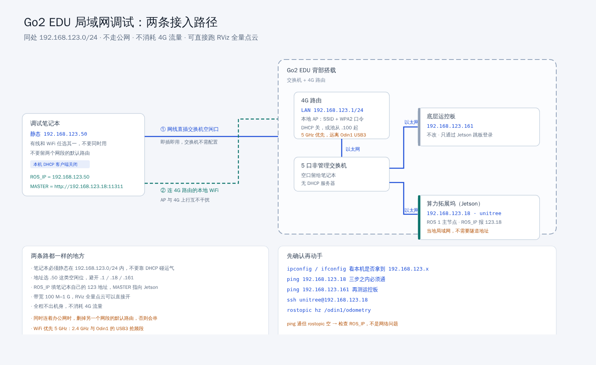

# LAN Debugging (Cable to the Switch / Local WiFi)

**English** | [中文](lan-debug.zh-CN.md)

> **When to use**: you are on site, or in the same building as the dog. The goal is **lowest
> latency and maximum bandwidth** — first power-on, sensor calibration, packet capture, full
> point clouds, parameter edits, rosbag recording.
> For connecting from somewhere else, see [4G remote debugging](remote-debug.md).



LAN access is far simpler than 4G: **no NAT, no tunnel, no bandwidth anxiety**. There is exactly
one thing to get right — the laptop's address must live inside `192.168.123.0/24`.

---

## 1. Two paths, pick one

| | ① Cable into the switch | ② Local WiFi on the 4G router |
| --- | --- | --- |
| Latency | lowest, stable under 1 ms | 1–3 ms, subject to channel and interference |
| Bandwidth | saturates 100 M / 1 G | 2.4 GHz typically 20–60 Mbps real; 5 GHz more |
| Stability | best, immune to radio noise | drops when the dog moves or metal blocks the path |
| Convenience | needs a cable; a moving dog will yank it | untethered, but coverage depends on position |
| Use for | **calibration, bag recording, full-cloud RViz, stair debugging** | quick checks, walking observation, fast verification |

**Path ① for real work, path ② for a glance.** Both may exist at once (never connect the laptop
to both — pick one).

---

## 2. Prerequisites for both

### 2.1 The laptop needs a static address in the 123 subnet

| Item | Value |
| --- | --- |
| IP | `192.168.123.50` (or `.51`, `.60`, any free slot) |
| Mask | `255.255.255.0` |
| Gateway | empty, or `192.168.123.1` (only needed to reach the internet via the router) |
| DNS | empty; debugging does not need it |

**Avoid `.1` (router), `.18` (Jetson), `.161` (motion board).** All three are fixed; colliding
with one makes both sides unreachable while both still appear "up".

### 2.2 Do not rely on DHCP

The onboard switch is **unmanaged** and runs no DHCP. Following the [4G guide](remote-debug.md),
the router's DHCP is **off** (or pooled above `.100`). Therefore:

- Wired → the laptop gets no lease; **set it statically**
- WiFi → if the router's pool starts at `.100` it may work, but **a static address is still
  recommended** for reproducibility

### 2.3 Do not keep the laptop on two subnets

If the laptop is still on office WiFi it will hold two default routes. Symptoms:

- The dog pings, but `ssh` hangs, or `rostopic` connects then drops
- Intermittent and non-deterministic, depending on which route wins

Fix: **turn office WiFi off while debugging**, or delete its default route (the direct 123
route stays).

---

## 3. Path ① — cable into the switch

The switch has five ports; three are used (router, motion board, dock), **at least two are free**.

1. Any straight patch cable, one end into the laptop, one into a **free port**
2. Set the laptop NIC to `192.168.123.50 / 255.255.255.0`
3. Wait a few seconds for the link LED, then:

```bash
ping -c 3 192.168.123.18     # Jetson
ping -c 3 192.168.123.161    # motion board
ssh unitree@192.168.123.18
```

All three passing means you are done. **Nothing to configure on the switch** — it is pure layer 2.

> Keep the cable short. A 2 m cable on the floor gets run over or hooked by a leg while the dog
> walks. For debugging a moving robot, use path ②.

---

## 4. Path ② — local WiFi on the 4G router

Requires the router's AP to be enabled. Check these in its web UI:

| Item | Suggest | Note |
| --- | --- | --- |
| AP | on | some models ship with it off, wired only |
| SSID | custom, e.g. `go2-debug` | never the default name; duplicates nearby cause mis-association |
| Security | WPA2-PSK | never an open network |
| Band | **5 GHz preferred** | 2.4 GHz fights Odin1's USB 3, measured packet loss |
| Channel | 5 G: 36–48 / 2.4 G: 1, 6, 11 | stay clear of other APs on site |
| DHCP | off, or pool from `192.168.123.100` | consistent with the 4G setup |

After joining:

```bash
ipconfig            # Windows
ifconfig en0        # macOS
ip a                # Linux
```

- `192.168.123.x` → ready
- `169.254.x.x` → no DHCP answer; set `192.168.123.50` manually
- `192.168.0.x` / `192.168.1.x` → **the router LAN is still factory default**; go fix it per the 4G guide

Then the same three `ping` + `ssh` checks.

### When 2.4 GHz drops packets

Symptoms: `ping` comes and goes, `over 30% packet loss`, clouds stutter.

1. Move to 5 GHz (most effective)
2. Keep antennas clear of the Jetson's metal shell and Odin1's USB 3 cable
3. Get closer; avoid a wall in between
4. Lower RViz `Decay Time`, or temporarily subscribe only to `/tf` and `/path`

> The 2.4 GHz / USB 3 conflict is known on this platform (Odin1 streams clouds over USB 3, whose
> broadband noise sits right on 2.4 GHz). Use 5 GHz whenever available.

---

## 5. Setting a static address

| OS | Path |
| --- | --- |
| Windows 10/11 | Settings → Network & Internet → Ethernet (or WiFi) → IP assignment → Edit → Manual → IPv4 on, `192.168.123.50` / `255.255.255.0`, gateway empty |
| macOS | System Settings → Network → select the interface → Details → TCP/IP → Configure IPv4: Manually |
| Ubuntu | Settings → Network → gear → IPv4 → Manual → Address `192.168.123.50/24`, gateway empty |

Verify with `ping`, not with the icon — an icon can look connected while the address is `169.254.x.x`.

---

## 6. ROS 1 over LAN

On a LAN there is **no tunnel address** to report; the 123 subnet works directly.

```bash
# laptop
export ROS_MASTER_URI=http://192.168.123.18:11311
export ROS_IP=192.168.123.50
```

Jetson keeps its normal values:

```bash
export ROS_MASTER_URI=http://192.168.123.18:11311
export ROS_IP=192.168.123.18
```

Verify:

```bash
rostopic list
rostopic hz /odin1/odometry
rostopic bw /odin1/cloud_slam        # LAN saturates; record this as your baseline
```

**Why the 4G trap does not apply here**: remotely, the Jetson must declare the tunnel address
or the peer cannot route to it; on a LAN `192.168.123.18` is directly reachable, so the original
values are correct. Which is also why **before leaving site you must confirm `ROS_IP` is back to
`192.168.123.18`** — forget it and the next 4G session sees no data.

---

## 7. What a LAN lets you do that 4G does not

| Capability | Note |
| --- | --- |
| **Full point clouds in RViz** | subscribe to `/odin1/cloud_slam` directly, no stutter — mapping, floor switching and A* paths are best debugged this way |
| **rosbag recording** | `rosbag record -O floor1.bag /odin1/cloud_slam /odin1/odometry /tf` on the laptop; fast Ethernet records for a long time |
| **Remote roslaunch** | `roslaunch --screen` with live logs |
| **rqt / rqt_graph** | node topology and live parameter edits (`rqt_reconfigure`) |
| **Bandwidth baseline** | `rostopic bw` the raw rates; compare later to decide what to cut over 4G |
| **Packet capture** | `tcpdump` for loss and hogs |
| **Remote coding** | VS Code Remote SSH into the Jetson repository |

**Do not**:

- install anything on the motion board (it runs Unitree's real-time system)
- change the addresses of `.18` or `.161`
- introduce a second DHCP-capable device into the body (even a spare router)
- plug or unplug cables while the dog is running — Odin1's USB or the network blips and the
  current task is aborted

---

## 8. Acceptance checklist

| # | Check | Command | Pass |
| --- | --- | --- | --- |
| 1 | Local address | `ipconfig` / `ifconfig` / `ip a` | `192.168.123.50`, not `169.254.x` |
| 2 | Jetson reachable | `ping -c 3 192.168.123.18` | replies; < 1 ms wired, 1–3 ms WiFi |
| 3 | Board reachable | `ping -c 3 192.168.123.161` | replies |
| 4 | SSH | `ssh unitree@192.168.123.18` | login |
| 5 | ROS registration | `rostopic list` | topics visible |
| 6 | ROS data | `rostopic hz /odin1/odometry` | a rate appears |
| 7 | Bandwidth baseline | `rostopic bw /odin1/cloud_slam` | record it |
| 8 | Loss | `ping -c 200 192.168.123.18` | WiFi < 5%, wired 0% |

---

## 9. Troubleshooting

| Symptom | Cause | Fix |
| --- | --- | --- |
| Link LED off | bad cable, or plugged into the router's WAN port | swap cable; any switch port works, just not the WAN port |
| Got `169.254.x.x` | no DHCP answer, OS assigned a link-local address | set `192.168.123.50` manually |
| Got `192.168.0.x` | router LAN still factory default | set `192.168.123.1/24`, reboot the router |
| Ping works, ssh hangs | laptop holds two default routes | disable the other WiFi, delete the extra route |
| `rostopic list` empty | `ROS_MASTER_URI` wrong, or no roscore on the Jetson | check `echo $ROS_MASTER_URI` |
| `rostopic list` fine, `hz` empty | `ROS_IP` wrong — often a stale 4G value | set `192.168.123.50` / `.18` |
| WiFi works but loss is severe | 2.4 GHz USB 3 interference | move to 5 GHz, antennas away from the USB 3 cable |
| RViz stutters | fast Ethernet plus several heavy topics | `rostopic bw` to find the hog; drop image topics first |
| Odin1 drops after plugging a cable | power/USB disturbed | plug gently and keep away from the USB cable |

---

## 10. Switching between LAN and 4G

| Situation | Laptop | Jetson `ROS_IP` | Access |
| --- | --- | --- | --- |
| On-site LAN | `192.168.123.50` | `192.168.123.18` | `http://192.168.123.18:11311` |
| Remote 4G | `100.x` (tunnel) | `100.x` (tunnel) | `http://<jetson-100.x>:11311` |

**One line changes, and getting it wrong means no data.** Keep two scripts on the Jetson:

```bash
# ~/ros_lan.sh
export ROS_IP=192.168.123.18
export ROS_MASTER_URI=http://192.168.123.18:11311

# ~/ros_4g.sh
export ROS_IP=$(tailscale ip -4)
export ROS_MASTER_URI=http://$ROS_IP:11311
```

Run `~/ros_lan.sh` before leaving site, or let `~/.bashrc` decide by testing whether the 4G
uplink is up.
