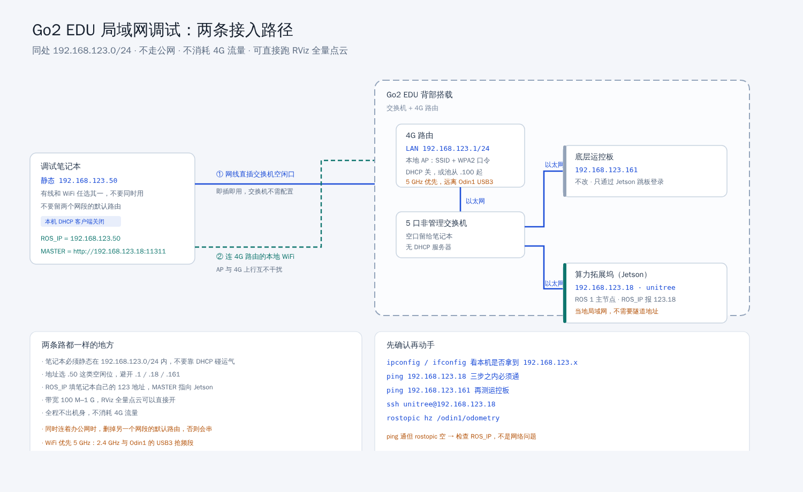

# 局域网调试（网线直连 / 本地 WiFi）

[English](lan-debug.md) | **中文**

> **适用**：人在现场、或机器狗与你在同一个楼里。目标是**最低延迟、最大带宽**地调东西 ——
> 首次上机、标定传感器、抓包、看全量点云、改参数、录 rosbag。
> 需要人不在现场时怎么连，见 [4G 远程调试](remote-debug.zh-CN.md)。



局域网接入比 4G 简单得多：**没有 NAT、没有隧道、没有带宽焦虑**。
只有一件事要小心 —— 笔记本的地址必须落在 `192.168.123.0/24` 里。

---

## 1. 两条路，选哪个

| | ① 网线接交换机 | ② 连 4G 路由的本地 WiFi |
| --- | --- | --- |
| 延迟 | 最低，稳定 < 1 ms | 1–3 ms，受 WiFi 信道与干扰影响 |
| 带宽 | 100 M / 1 G 实测跑满 | 2.4 G 频段通常 20–60 Mbps 实际；5 G 可更高 |
| 稳定性 | 最好，不受无线干扰 | 机器狗移动、金属遮挡会掉包 |
| 便利性 | 要拉一根线，狗动起来线会被扯 | 无束缚，但信号覆盖要看位置 |
| 适合 | **标定、录 bag、跑 RViz 全量点云、爬楼调试** | 短时检查、走动观察、快速验证 |

**做正经调试用 ①，临时看一眼用 ②。** 两条路可以同时存在（一台设备接两根反而会乱，
笔记本只选一条）。

---

## 2. 通用前提（两条路都适用）

### 2.1 笔记本必须静态在 123 网段

| 项 | 值 |
| --- | --- |
| 笔记本 IP | `192.168.123.50`（或 `.51` `.60` 等空闲位） |
| 子网掩码 | `255.255.255.0` |
| 网关 | **留空**，或填 `192.168.123.1`（走 4G 路由时才需要它出网） |
| DNS | 留空。调试不需要 |

**避开这三个地址**：`.1`（4G 路由）、`.18`（Jetson 拓展坞）、`.161`（运控板）。
这三个是固定的，撞上就会互相打死，现象是"两边都在但谁都连不上谁"。

### 2.2 不要靠 DHCP 碰运气

车身交换机是**非管理型**、不跑 DHCP。4G 路由按 [4G 方案](remote-debug.zh-CN.md) 的配置
**关掉了 DHCP**（或把池抬到 `.100` 以上）。所以：

- 有线接入 → **笔记本拿不到自动地址，必须手填静态**
- WiFi 接入 → 若路由开了 DHCP 且池从 `.100` 起，笔记本可以自动拿；但为了可复现，
  **仍然建议手填静态**

### 2.3 别让笔记本同时挂在两个网段

笔记本如果还连着办公网 WiFi，会出现两个默认路由。表现：

- 能 ping 通狗，但 `ssh` 卡住 / `rostopic` 连上又断
- 症状随机，取决于哪条路由先被选中

处理：**调试期间关掉办公网 WiFi**，或把办公网的默认路由删掉（保留 123 网段直连即可）。

---

## 3. 路径 ①：网线直连交换机

交换机上有 5 个口，已占用 3 个（4G 路由、运控板、拓展坞），**至少还剩 2 个空口**。

1. 找一根普通网线（直通线即可，非管理交换机不需要交叉线），一头插笔记本，一头插**任一空闲口**
2. 笔记本网卡设为静态 `192.168.123.50 / 255.255.255.0`
3. 等 3–5 秒，链路灯亮起后：

```bash
ping -c 3 192.168.123.18     # Jetson
ping -c 3 192.168.123.161    # 运控板
ssh unitree@192.168.123.18
```

三条全通就完成了。**不需要在交换机上做任何配置** —— 它是纯二层转发，插上就通。

> 网线别太长。狗在跑的时候，一根 2 m 的线横在地上会被轮子压住、被腿勾住。
> 要边跑边连，就用 ② 的 WiFi。

---

## 4. 路径 ②：连 4G 路由的本地 WiFi

前提是 4G 路由开了本地 AP。在路由管理页里确认这几项：

| 项 | 建议值 | 说明 |
| --- | --- | --- |
| AP 开关 | 开 | 有的型号默认关着，只做有线 |
| SSID | 自定义，如 `go2-debug` | 别用默认名，附近同名会连错 |
| 加密 | WPA2-PSK | 不要开放网络 |
| 频段 | **优先 5 GHz** | 2.4 GHz 与 Odin1 的 USB3 抢频段，实测会掉包 |
| 信道 | 5 G 选 36–48 / 2.4 G 选 1、6、11 | 避开现场其他 AP |
| DHCP | 关（或池从 `192.168.123.100` 起） | 与 4G 方案一致 |

笔记本连上后：

```bash
# 查拿到的地址
ipconfig            # Windows
ifconfig en0        # macOS
ip a                # Linux
```

- 拿到 `192.168.123.x` → 直接可用
- 拿到 `169.254.x.x` → DHCP 没应答，手填静态 `192.168.123.50`
- 拿到 `192.168.0.x` / `192.168.1.x` → **路由 LAN 还是出厂默认**，回 4G 方案去改

然后同样三条 `ping` + `ssh` 验证。

### 2.4 G 掉包时怎么办

现象：`ping` 时通时不通、`over 30% packet loss`、点云一顿一顿。

1. 换 5 GHz（最有效）
2. 把路由天线远离 Jetson 金属壳与 Odin1 的 USB3 线
3. 笔记本靠近狗，别隔墙
4. 降 RViz 的 `Decay Time`，或临时只订 `/tf` `/path`

> 2.4 GHz 与 USB3 的冲突是这个平台的已知问题（Odin1 靠 USB3 传点云，USB3 的宽带噪声
> 正好压在 2.4 GHz 上）。能上 5 GHz 就不要用 2.4 GHz。

---

## 5. 笔记本怎么设静态地址

| 系统 | 路径 |
| --- | --- |
| Windows 10/11 | 设置 → 网络和 Internet → 以太网（或 WiFi）→ IP 分配 → 编辑 → 手动 → IPv4 开，填 `192.168.123.50` / `255.255.255.0`，网关留空 |
| macOS | 系统设置 → 网络 → 选中接口 → 详细信息 → TCP/IP → 配置 IPv4：手动 |
| Ubuntu | 设置 → 网络 → 齿轮 → IPv4 → 手动 → Address `192.168.123.50/24`，网关留空 |

设完用 `ping` 验证，不要只看图标亮没亮 —— 图标亮着但地址是 `169.254.x.x` 的情况很常见。

---

## 6. ROS 1 环境（局域网版）

局域网里**不需要隧道地址**，直接用 123 网段即可：

```bash
# 笔记本
export ROS_MASTER_URI=http://192.168.123.18:11311
export ROS_IP=192.168.123.50
```

Jetson 侧保持原本的写法：

```bash
export ROS_MASTER_URI=http://192.168.123.18:11311
export ROS_IP=192.168.123.18
```

验证：

```bash
rostopic list
rostopic hz /odin1/odometry
rostopic bw /odin1/cloud_slam        # 局域网能跑满，记下这个数作为基准
```

**为什么局域网没有 4G 那个坑**：4G 场景下 Jetson 必须报隧道地址，否则远程路由不到；
局域网里 `192.168.123.18` 本身可达，按原写法即可。这也是为什么**离开现场前要确认
Jetson 的 `ROS_IP` 又回到了 `192.168.123.18`** —— 忘了改回来，回到 4G 远程时就收不到数据。

---

## 7. 局域网上能做什么（4G 上做不了的）

| 能做 | 说明 |
| --- | --- |
| **RViz 全量点云** | 直接订 `/odin1/cloud_slam`，不卡。调建图、看楼梯切层、看 A* 路径全靠这个 |
| **录 rosbag** | 笔记本 `rosbag record -O floor1.bag /odin1/cloud_slam /odin1/odometry /tf`，百兆链路可长时间录 |
| **远程 roslaunch** | `roslaunch --screen` 直接跑，日志实时回传 |
| **rqt / rqt_graph** | 看节点拓扑、改参数（`rqt_reconfigure`） |
| **测带宽基准** | `rostopic bw` 记下原始速率，回去对比 4G 就知道该砍多少话题 |
| **抓包** | `tcpdump` 看丢包、看谁在抢带宽 |
| **远程改代码** | VS Code Remote SSH，编辑 Jetson 上的仓库 |

**不要做的事**：

- 不要在运控板上装任何东西（它跑 Unitree 实时系统）
- 不要改 `.18` 和 `.161` 的地址
- 不要在车身里插第二个会发 DHCP 的设备（哪怕是一台"顺手"的路由器）
- 狗在跑时不要插拔网线 —— 会让 Odin1 的 USB 或网络中断一下，正在跑的任务会中断

---

## 8. 验收清单

| # | 检查 | 命令 | 通过标准 |
| --- | --- | --- | --- |
| 1 | 本机地址 | `ipconfig` / `ifconfig` / `ip a` | `192.168.123.50`，不是 `169.254.x` |
| 2 | Jetson 可达 | `ping -c 3 192.168.123.18` | 通，局域网 < 1 ms 或 WiFi 1–3 ms |
| 3 | 运控板可达 | `ping -c 3 192.168.123.161` | 通 |
| 4 | SSH | `ssh unitree@192.168.123.18` | 能登录 |
| 5 | ROS 注册 | `rostopic list` | 话题可见 |
| 6 | ROS 数据 | `rostopic hz /odin1/odometry` | 有频率输出 |
| 7 | 带宽基准 | `rostopic bw /odin1/cloud_slam` | 记下数值 |
| 8 | 丢包率 | `ping -c 200 192.168.123.18` | WiFi 下 < 5%，有线 0% |

---

## 9. 排障

| 现象 | 原因 | 处理 |
| --- | --- | --- |
| 链路灯不亮 | 网线坏 / 插错口（插到 WAN 口） | 换线；交换机任意口都行，但要避开路由的 WAN 口 |
| 拿到 `169.254.x.x` | DHCP 无应答，系统自动分配了链路本地地址 | 手填静态 `192.168.123.50` |
| 拿到 `192.168.0.x` | 4G 路由 LAN 还是出厂默认 | 改 `192.168.123.1/24`，重启路由 |
| ping 得通，ssh 卡住 | 笔记本同时挂了办公网，路由串了 | 关掉另一个 WiFi，删多余默认路由 |
| `rostopic list` 空 | `ROS_MASTER_URI` 没指对，或 Jetson 上没起 roscore | `echo $ROS_MASTER_URI` 核对 |
| `rostopic list` 有，`hz` 空 | `ROS_IP` 设错（尤其从 4G 模式带回来的旧值） | 改成 `192.168.123.50` / `.18` |
| WiFi 通但丢包严重 | 2.4 GHz 被 USB3 干扰 | 换 5 GHz，天线远离 USB3 线 |
| RViz 卡 | 有线却只跑百兆 + 同时订多个大话题 | `rostopic bw` 看谁大，先砍图像话题 |
| 插网线后 Odin1 掉线 | 供电被拉扯 / USB 松动 | 拔插网线时要轻，别碰 USB 线 |

---

## 10. 和 4G 方案怎么切换

| 场景 | 笔记本 | Jetson `ROS_IP` | 访问方式 |
| --- | --- | --- | --- |
| 现场局域网 | `192.168.123.50` | `192.168.123.18` | `http://192.168.123.18:11311` |
| 远程 4G | `100.x`（隧道） | `100.x`（隧道） | `http://<jetson-100.x>:11311` |

**只有一行要改，但改错就没数据。** 建议把它做成 Jetson 上的两个脚本：

```bash
# ~/ros_lan.sh
export ROS_IP=192.168.123.18
export ROS_MASTER_URI=http://192.168.123.18:11311

# ~/ros_4g.sh
export ROS_IP=$(tailscale ip -4)
export ROS_MASTER_URI=http://$ROS_IP:11311
```

离场前跑一次 `~/ros_lan.sh`，或者干脆在 `~/.bashrc` 里按"有没有 4G 上行"自动判断。
