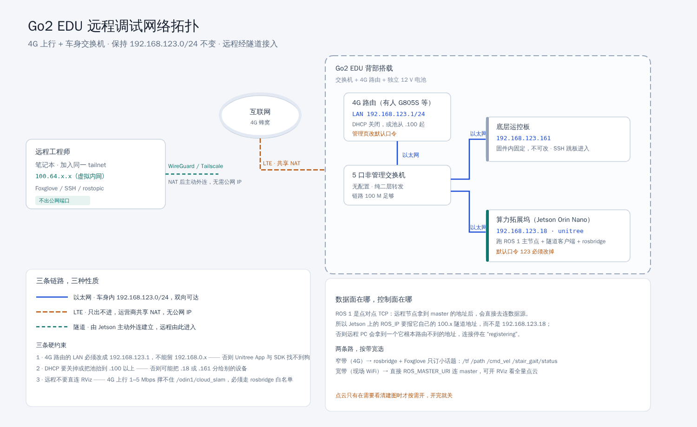

# 4G Remote Debugging (Go2 EDU + Onboard Switch)

**English** | [中文](remote-debug.zh-CN.md)

> [!NOTE]
> This page covers **4G remote access for the Go2 EDU (ROS 1 / Jetson Orin Nano) only**.
> The repository also ships [`docs/remote_monitoring.md`](../remote_monitoring.md), which is a
> ROS 2 (SW01) web console and **does not run on Go2** — it is built on `rclpy`, and the ROS 1
> launch files never bring it up. The two do not conflict: one solves "how the link works",
> the other solves "what UI to use once it does".

The site has no fixed broadband. The dog runs a full day across four floors of an office
building and the engineer is elsewhere. The goal is to **connect at any time, edit code, and
watch live data** without hunting for a network on site.



---

## 1. What exists on site, and what must not change

| Device | Address | Set by | Changeable |
| --- | --- | --- | --- |
| Low-level motion control board | `192.168.123.161` | Unitree firmware | **No.** Official app, SDK and `unitree_leedcan` all break |
| Compute dock (Jetson Orin Nano) | `192.168.123.18` | Factory image | Possible, but **don't**: every launch file, `/etc/hosts`, doc and script assumes it |
| Onboard switch | no IP | unmanaged | Nothing to configure; the only requirement is **no DHCP** |
| 4G router | to be set to `192.168.123.1` | us | Must change — factory default is usually `192.168.0.x` or `192.168.1.x` |

**This is the critical one**: all three devices must sit in `192.168.123.0/24`. Unitree firmware,
the phone app and the SDK hard-code that subnet. If the 4G router keeps its factory
`192.168.0.1` LAN it will hand out `192.168.0.x` leases, and the result is the dog **is** on
the network but the app cannot find it — a confusing symptom (the router pings, the dog does
not).

---

## 2. Hardware options

| Option | Composition | Pros | Cost |
| --- | --- | --- | --- |
| **A · all-in-one** (recommended start) | USR G805S or an equivalent 4G industrial router with LAN ports | One cable to the switch, two fewer power rails | Fixed LAN port count, usually 1–2; models vary — **check ports and input voltage against the unit's silkscreen/manual** |
| **B · CPE + switch** | 4G CPE (pure router) + 5-port unmanaged switch | Enough ports, swappable modem, replaceable parts | One more device, one more power rail |
| **C · site WiFi bridge** | switch + a small host acting as an AP bridge | Zero data cost | Depends on site network; office WiFi usually needs a captive portal, **bad for unattended long runs** |

Either works; the difference is cabling and power. **Do not buy a "router" that does DHCP for
the onboard switch** — a second DHCP server in the body is the classic failure here: whoever
answers first wins, and half the devices end up on the wrong subnet.

---

## 3. Configuration

### 3.1 4G router (four things in its web UI)

| Item | Set to | Why |
| --- | --- | --- |
| LAN subnet | `192.168.123.1/24` | Same subnet as the dog, so the app and SDK discover devices |
| DHCP | **off**; if it must stay on, pool from `192.168.123.100` | `.18` and `.161` are fixed — a pool covering them will hand those addresses to other devices, showing up as "the dog disappears occasionally" |
| WAN | 4G auto-dial, APN per carrier | Plug-and-play; use an **IoT or large-data SIM**, since remote debugging is always-on rather than bursty |
| Admin | change the factory password, disable remote/cloud management | This box lives on a carrier network permanently |

Confirm it has upstream connectivity:

```bash
ping -c 4 8.8.8.8
```

### 3.2 Switch (nothing to configure)

Three points only:

- **Unmanaged**, 5 ports, gigabit or fast Ethernet both fine (onboard traffic is point clouds;
  fast Ethernet ≈ 12 MB/s, enough for one 10 Hz cloud)
- Powered from its own DC input, never loop power to the router
- **Short patch cables** (15–30 cm); the dog moves and long cables get yanked

### 3.3 Jetson (`192.168.123.18`)

1. **Make sure DHCP has not taken the address**: `ip addr show` must show a static
   `192.168.123.18`. If it came from DHCP, pin it.
2. **Install the tunnel client** (section 4) — the only software configured once and left alone.
3. **Report the tunnel address in `ROS_IP`, not `192.168.123.18`** — see section 5, this is the
   most common trap.
4. Install `rosbridge` for narrowband work:

```bash
sudo apt install ros-noetic-rosbridge-server
roslaunch rosbridge_server rosbridge_websocket.launch
```

### 3.4 Motion control board (`192.168.123.161`)

Leave it alone; enter through the Jetson as a jump host:

```bash
ssh -J unitree@192.168.123.18 <board-user>@192.168.123.161
```

> The board runs Unitree's own real-time system — **install nothing on it**. Read state through
> the official `unitree_leedcan` / `unitree_sdk2` interfaces, or subscribe to ROS topics from
> the Jetson side.

---

## 4. Tunnel: three choices

4G is **carrier-grade NAT** with no public IP, so nothing outside can dial in. The robot side
must connect out.

| Option | Requires | Pros | Cons |
| --- | --- | --- | --- |
| **Tailscale** (recommended) | an account, or self-hosted headscale | zero-config NAT traversal, automatic virtual network, per-device ACL | depends on a coordination server; occasionally slow to connect from mainland China — self-host headscale if that matters |
| **Self-hosted WireGuard** | a VPS with a public IP | fully controlled, good bandwidth, stable latency | you maintain the VPS; needs `PersistentKeepalive` behind NAT |
| **frp / reverse SSH** | a VPS or an frp provider | simplest, just port mapping | solves "can connect" but not ROS 1 data back-connection; more mapped ports mean a larger attack surface |

### Tailscale (on the Jetson)

```bash
curl -fsSL https://tailscale.com/install.sh | sh
sudo tailscale up --ssh              # authorise, then it has a 100.x address
tailscale ip -4                       # note this down
sudo tailscale status
```

On the remote PC, install the same client on the same tailnet, then:

```bash
tailscale ping <jetson-name>          # confirm hole punching (relay works but adds latency)
ping -c 20 <jetson-100.x>             # jitter check
ssh unitree@<jetson-100.x>
```

### WireGuard (if self-hosting)

Point the Jetson's `wg0` at the VPS with `PersistentKeepalive = 25`; on the VPS, keep
`AllowedIPs` limited to that Jetson's onboard subnet. The remote PC joins as a peer too, but
**never let the PC's `AllowedIPs` capture all traffic** — routing the whole laptop through the
VPS makes latency measurements meaningless.

---

## 5. The ROS 1 data plane: why "connected but no data" happens

ROS 1 is not client-server. `ROS_MASTER_URI` is used only to **register and look up**; images,
point clouds and TF travel node-to-node over **direct TCP**. So:

```
remote PC ──(asks master)──► roscore on the Jetson
   │                              │
   └──── where is the data? ◄─────┘
        the master answers with the address the publisher declared
```

If Jetson nodes declare `192.168.123.18`, the remote PC takes that address and **cannot route
to it** (it is the body-internal subnet). The connection stalls at `registering` or times out.

**Correct setup**: give the Jetson's ROS environment the tunnel address.

```bash
# Jetson, before starting any ROS node
export ROS_IP=$(tailscale ip -4)          # e.g. 100.101.102.103
export ROS_MASTER_URI=http://$ROS_IP:11311
roscore
```

The Jetson can route to `100.x` itself (the tailscale interface is local), so local nodes are
unaffected.

```bash
# remote PC
export ROS_MASTER_URI=http://<jetson-100.x>:11311
export ROS_IP=$(tailscale ip -4)
rostopic list
rostopic hz /odin1/odometry
```

> On a site WiFi both sides share a LAN: use their LAN addresses in `ROS_IP` instead, and
> everything above still holds.

### Narrowband (4G) versus broadband (WiFi)

| Situation | Approach |
| --- | --- |
| **4G, watching a run** | `rosbridge` + Foxglove Studio on `ws://<jetson-100.x>:9090`, subscribing to **small topics only**: `/tf`, `/path`, `/cmd_vel`, `/stair_gait/status`, `/floor_manager/status`. **Never subscribe to `/odin1/cloud_slam`** |
| **Checking map quality** | open the cloud briefly, close it immediately. Remote RViz pulling full clouds over 4G will freeze and consume the whole uplink |
| **Site WiFi or on-site** | connect `ROS_MASTER_URI` to the master and run RViz normally |

Measure the bandwidth, do not guess:

```bash
rostopic bw /odin1/cloud_slam        # bytes/second, frame size × rate
rostopic bw /odin1/image/compressed
```

`web_video_server` streams compressed images on demand and costs far less than raw images over
rosbridge:

```bash
rosrun web_video_server web_video_server _port:=8080
```

---

## 6. Power and mounting

### 6.1 Power

| Device | Order of magnitude | Note |
| --- | --- | --- |
| 4G router (G805S class) | ~5–8 W steady, higher peaks while transmitting | **use the vendor datasheet**, leave headroom for peaks |
| 5-port unmanaged switch | ~2–4 W | fast Ethernet draws less |
| Total | **~10–15 W** | a 12 V / 1.5 A supply is enough |

**Do not power it from the Jetson's USB ports.** The dock's USB power is shared with Odin1,
which already runs over USB 3 (the `lsusb` output shows a USB 3.20 device). Adding a 4G router's
peak current collapses that rail, and the symptom is **Odin1 re-enumerating and the cloud
stream dropping** — the same class of USB 3 power/interference problem already documented
elsewhere in this repository.

Recommended:

- **A dedicated 12 V pack** (`12 V / 5000 mAh` ≈ 60 Wh, roughly 4 h at 15 W; use 10000 mAh or
  more for a full day)
- Or the body's 12 V output (**verify on the actual unit** — do not assume it exists), fused,
  feeding router and switch

### 6.2 Placement and interference

- Switch and battery **on the back's centre line**, cables zip-tied to the plate, never across joints
- 4G antennas **vertical, pointing up, away from sheet metal**, routed apart from Odin1's USB 3
  cable (USB 3 broadband noise hurts 2.4 GHz; at 4G frequencies a nearby high-current cable
  still drags the rate down)
- Keep antennas off the Jetson's exhaust — hottest spot on the body
- Total added mass (router + switch + battery + cable) **under 1 kg**, mounted near the centre of
  gravity. Check the real payload and endurance figures in the official specs, and **re-measure
  endurance and stair climbing after installation**

---

## 7. Security

This turns the dog into an internet-reachable host. Four non-negotiables:

1. **Change `unitree/123`**. The default is public knowledge and must not survive on a 4G-connected machine.
2. **Never map 22 / 9090 to the internet.** Go through the tunnel (Tailscale ACL or WireGuard `AllowedIPs` allowlist).
3. **Disable the 4G router's cloud/remote management**, change its admin password, close SSH/telnet management.
4. **Cap the data plan usage.** IoT SIMs throttle or cut off; a runaway cloud subscription can burn a monthly quota in days.

---

## 8. Acceptance checklist

Run these in order; each has a pass/fail you can judge on the spot:

| # | Check | Command | Pass |
| --- | --- | --- | --- |
| 1 | Body-internal reachability | `ping -c 3 192.168.123.161` (on Jetson) | replies, < 2 ms |
| 2 | Address not stolen | `ip addr show` (Jetson) | still static `.18` |
| 3 | 4G uplink | `ping -c 4 8.8.8.8` | replies |
| 4 | Tunnel | remote: `tailscale ping <jetson>` | direct or relay, latency acceptable |
| 5 | Remote SSH | `ssh unitree@<jetson-100.x>` | login works |
| 6 | Jump to board | `ssh -J unitree@<jetson-100.x> ...@192.168.123.161` | login works |
| 7 | ROS registration | remote `rostopic list` | topics visible |
| 8 | ROS data | remote `rostopic hz /odin1/odometry` | a rate appears (not 0, not stalled at registering) |
| 9 | Bandwidth | remote `rostopic bw /odin1/cloud_slam` | record it; compare against the 4G uplink |
| 10 | Reconnect | unplug the 4G antenna for 30 s, replug | tunnel recovers without restarting processes |
| 11 | Soak | 30 min continuous | no drops, no memory growth |

---

## 9. Troubleshooting

| Symptom | Most likely cause | Fix |
| --- | --- | --- |
| Official app cannot find the dog, router pings fine | router LAN still `192.168.0.x`, wrong subnet handed out | set LAN to `192.168.123.1/24`, reboot router |
| Dog vanishes intermittently, replugging the cable helps | router DHCP leased `.18`/`.161` to something else | disable DHCP or move the pool to `.100`+ |
| `rostopic list` works but `rostopic hz` stays empty | `ROS_IP` declares `192.168.123.18`, unreachable from remote | `export ROS_IP=$(tailscale ip -4)` on Jetson, restart nodes |
| Remote RViz freezes and the link dies | subscribed to the full `/odin1/cloud_slam` | whitelist topics in rosbridge, open clouds only on demand |
| SSH to Jetson fine, board unreachable | wrong jump syntax / board cable unplugged | `ping 192.168.123.161` from the Jetson first |
| Odin1 drops out after minutes, cloud stops | USB rail collapsed by the 4G router's peaks | power router and switch from a dedicated pack |
| 4G drops often | weak signal / poor antenna placement / throttled SIM | raise antennas clear of metal, check SIM status and quota |
| Latency spikes randomly | Tailscale relaying instead of direct | `tailscale status` to check `relay`; self-host WireGuard or switch networks |

---

## 10. Relationship to `docs/remote_monitoring.*`

| | `remote_monitoring.md` | This page |
| --- | --- | --- |
| Platform | ROS 2 (SW01) | **ROS 1 (Go2 EDU)** |
| Solves | what UI to use once connected: status, intercom, e-stop, on-demand camera | **how the link works**: topology, IP plan, tunnel, bandwidth |
| Depends on | `rclpy` | Jetson + tunnel client + (optional) `rosbridge` |

For graphical operation on Go2, use `rosbridge` + Foxglove. If the e-stop/intercom interaction
also needs to work remotely, port the interface design from `remote_monitoring` into a ROS 1
implementation — the shipped one **will not start**, because it imports `rclpy`.
