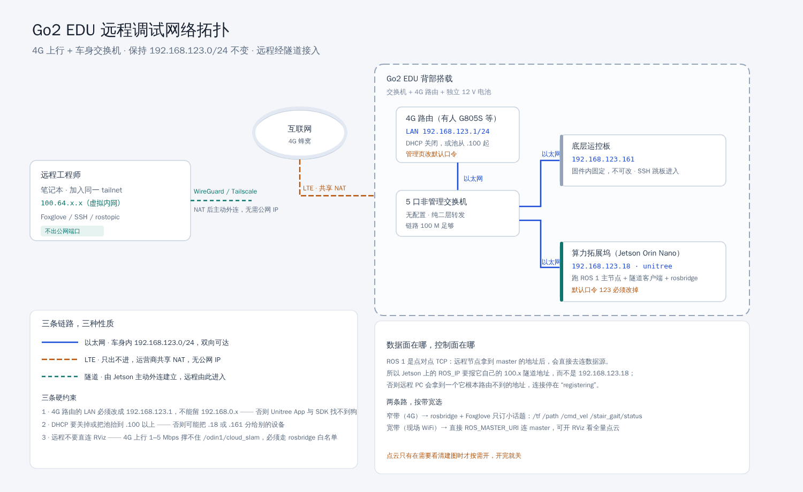

# 4G 远程调试（Go2 EDU + 车身交换机）

[English](remote-debug.md) | **中文**

> [!NOTE]
> 本文只讲 **Go2 EDU（ROS 1 / Jetson Orin Nano）的 4G 远程接入**。
> 仓库里另有一份 [`docs/remote_monitoring.zh-CN.md`](../remote_monitoring.zh-CN.md)，
> 那是 ROS 2（SW01）专用的 Web 控制台，**不适用 Go2** —— 它靠 `rclpy` 运行，ROS 1 的
> 启动脚本不会拉起它。两者不冲突：一个解决"网络怎么通"，一个解决"通了之后用什么界面"。

现场没有固定宽带，机器狗要在四层办公楼里跑一整天，人在外地。目标是**随时能连上、能改代码、
能看实时数据**，而且不需要在现场找网。



---

## 1. 现场有什么，什么不能动

| 设备 | 地址 | 谁配的 | 能不能改 |
| --- | --- | --- | --- |
| 底层运控板 | `192.168.123.161` | Unitree 固件写死 | **不改**。改了官方 App、SDK、`unitree_leedcan` 全失效 |
| 算力拓展坞（Jetson Orin Nano） | `192.168.123.18` | 出厂镜像 | 可改，但**不要改**：全套 launch、`/etc/hosts`、文档、脚本都按这个地址写 |
| 车身交换机 | 无 IP | 非管理型 | 无需配置，唯一要求是**别把 DHCP 引进来** |
| 4G 路由 | 待配 `192.168.123.1` | 我们自己 | 必须改 —— 出厂默认通常是 `192.168.0.x` 或 `192.168.1.x` |

**这条最关键**：三台设备必须同处 `192.168.123.0/24`。Unitree 的固件、手机 App 和 SDK 都硬编码
了这个网段，4G 路由如果留在出厂默认的 `192.168.0.1`，它会给下挂设备发 `192.168.0.x` 的地址，
结果就是**狗在网里但 App 找不到它**，且现象很迷惑（能 ping 通路由，ping 不通狗）。

---

## 2. 硬件形态

| 形态 | 组成 | 优点 | 代价 |
| --- | --- | --- | --- |
| **A · 一体机**（推荐起点） | 有人 G805S 或同级 4G 工业路由（自带 LAN 口） | 一根线接交换机就通，少两个电源 | LAN 口数量固定，通常 1–2 个；型号差异大，**端口与供电电压按实物丝印/手册核对** |
| **B · CPE + 交换机** | 4G CPE（纯路由）+ 5 口非管理交换机 | 端口够、可换模组、坏了能单独换 | 多一台设备、多一路供电 |
| **C · 现场 WiFi 桥** | 仅交换机 + 一台小主机做 AP 桥 | 零流量成本 | 依赖现场网络，办公楼 WiFi 常要 Portal 认证，**不适合长期无人值守** |

两种都行，差别只在布线和电源。**交换机不要买带 DHCP 的"路由器"** —— 车身里出现第二个 DHCP
服务器是这类现场最典型的故障源（谁先应答谁发地址，结果一半设备拿到错的网段）。

---

## 3. 配置步骤

### 3.1 4G 路由（进管理页，四件事）

| 项 | 设成 | 为什么 |
| --- | --- | --- |
| LAN 网段 | `192.168.123.1/24` | 与狗同网段，App 与 SDK 才能发现设备 |
| DHCP | **关闭**；若必须开，地址池从 `192.168.123.100` 起 | `.18` 和 `.161` 是固定的，池子覆盖到它们就会把这两个地址分给别人，表现为"狗偶尔失联" |
| WAN | 4G 自动拨号，APN 按运营商 | 插卡即通；SIM 用**物联网卡或大流量卡**，远程调试是长期在线而非短时突发 |
| 管理口令 | 改掉出厂口令，关掉"远程管理/云平台" | 这台设备会长期暴露在公网运营商网络里 |

拨上之后确认路由自身能上网：

```bash
# 在路由管理页或 Jetson 上
ping -c 4 8.8.8.8
```

### 3.2 交换机（什么都不用配）

要点只有三条：

- **非管理型**，5 口千兆或百兆都够（车身内流量是点云，百兆约 12 MB/s，够单路 10 Hz 点云）
- 供电用独立 DC，不要从交换机取电给路由
- 网线用**短跳线**（15–30 cm），狗在动，长线会被甩

### 3.3 Jetson（`192.168.123.18`）

1. **确认地址没被 DHCP 抢走**：`ip addr show` 应为静态 `192.168.123.18`；若是 DHCP 拿到的，
   改成静态。
2. **装隧道客户端**（见第 4 节），这是整套方案里唯一需要"配一次就好"的软件。
3. **`ROS_IP` 报隧道地址，不报 `192.168.123.18`** —— 细节见第 5 节，这是最容易踩的坑。
4. 装 `rosbridge`（窄带调试用）：

```bash
sudo apt install ros-noetic-rosbridge-server
# 只监听在隧道接口没有意义，rosbridge 默认 0.0.0.0:9090，靠防火墙与 ACL 收口
roslaunch rosbridge_server rosbridge_websocket.launch
```

### 3.4 运控板（`192.168.123.161`）

不改，只通过 Jetson 跳板进入：

```bash
# 在 Jetson 上先登录，再从 Jetson 跳
ssh -J unitree@192.168.123.18 <运控板用户名>@192.168.123.161
```

> 运控板跑的是 Unitree 自己的实时系统，**不要在上面装东西**。要读状态就用官方
> `unitree_leedcan` / `unitree_sdk2` 的接口，或从 Jetson 侧订阅 ROS 话题。

---

## 4. 隧道：三种选择

4G 是**运营商共享 NAT**，没有公网 IP，外部无法主动拨入。必须由机身侧主动外连。

| 方式 | 需要准备 | 优点 | 缺点 |
| --- | --- | --- | --- |
| **Tailscale**（推荐） | 一个账号（或自建 headscale） | 零配置穿透，设备间自动组虚拟内网，ACL 可限设备 | 依赖第三方协调服务器；国内偶有连接慢，可自建 headscale |
| **WireGuard 自建** | 一台公网 VPS | 完全可控、带宽好、延迟稳定 | 要维护 VPS；NAT 后需 `PersistentKeepalive` |
| **frp / 反向 SSH** | 公网 VPS 或 frp 服务 | 最简单，只映射端口 | 只解决"能连"，不解决 ROS 1 数据回连；映射多个端口时安全面变大 |

### Tailscale（Jetson 上）

```bash
curl -fsSL https://tailscale.com/install.sh | sh
sudo tailscale up --ssh              # 授权后拿到 100.x 地址
tailscale ip -4                       # 记下这个地址，后面要用
sudo tailscale status                 # 远程 PC 侧核对是否在同一 tailnet
```

远程 PC 装同款客户端、登录同一 tailnet，然后：

```bash
tailscale ping <jetson-name>          # 先确认打洞成功（走中继也能通，但延迟高）
ping -c 20 <jetson-100.x>             # 看延迟抖动
ssh unitree@<jetson-100.x>            # 直连 Jetson
```

### WireGuard（若要自建）

Jetson 上 `wg0` 指向 VPS，`PersistentKeepalive = 25`；VPS 侧 `AllowedIPs` 只放这台 Jetson 的
内网段。远程 PC 也作为 peer 接入，但**不要让 PC 的 `AllowedIPs` 覆盖全部流量**，否则笔记本
所有上网都绕 VPS，调试时会误判延迟。

---

## 5. ROS 1 的数据面：为什么远程常常"连上了但没数据"

ROS 1 不是客户端-服务器模型。`ROS_MASTER_URI` 只用来**注册和查询**，真正的图像、点云、TF
都是节点之间**点对点 TCP 直连**。所以：

```
远程 PC ──(拿 master 地址)──► Jetson 上的 roscore
   │                              │
   └──── 但数据源是谁？◄───────────┘
        master 会告诉它：数据在 <发布者报上来的地址>
```

如果 Jetson 上节点报的是 `192.168.123.18`，远程 PC 拿到这个地址后**根本路由不到**（那是车身
内网），连接会停在 `registering` 或者直接超时。

**正确做法**：Jetson 侧的 ROS 环境把 `ROS_IP` 设成隧道地址。

```bash
# Jetson，在启动任何 ROS 节点之前
export ROS_IP=$(tailscale ip -4)          # 例如 100.101.102.103
export ROS_MASTER_URI=http://$ROS_IP:11311
roscore
```

Jetson 本机自己也能路由到 `100.x`（tailscale 接口就在本机），所以本地节点不受影响。

```bash
# 远程 PC
export ROS_MASTER_URI=http://<jetson-100.x>:11311
export ROS_IP=$(tailscale ip -4)          # PC 自己的隧道地址
rostopic list
rostopic hz /odin1/odometry
```

> 如果两边都在同一局域网（现场 WiFi），把 `ROS_IP` 换成各自的局域网地址即可，这一段完全一样。

### 窄带（4G）与宽带（WiFi）分开对待

| 场景 | 做法 |
| --- | --- |
| **4G 窄带，远程盯着跑** | `rosbridge` + Foxglove Studio 连 `ws://<jetson-100.x>:9090`，**只订小话题**：`/tf` `/path` `/cmd_vel` `/stair_gait/status` `/floor_manager/status`。**不要订 `/odin1/cloud_slam`** |
| **要看建图质量** | 临时开点云，看完立刻关。远程 RViz 拉全量点云在 4G 上必然卡死，且会吃掉整条上行 |
| **现场 WiFi 或人在车里** | 直接 `ROS_MASTER_URI` 连 master，RViz 全开，体验与本地一致 |

带宽量级先自己量，不要拍脑袋：

```bash
rostopic bw /odin1/cloud_slam        # 单帧大小 × 频率，B/s
rostopic bw /odin1/image/compressed
```

`web_video_server` 可以按需出压缩图像流，比 rosbridge 传原始图像省得多：

```bash
rosrun web_video_server web_video_server _port:=8080
# 浏览器只在你打开页面时才拉流
```

---

## 6. 供电与安装

### 6.1 供电

| 设备 | 功率量级 | 说明 |
| --- | --- | --- |
| 4G 路由（G805S 级） | 约 5–8 W 常态，发射峰值更高 | **以厂商手册为准**，按峰值留余量 |
| 5 口非管理交换机 | 约 2–4 W | 百兆更省 |
| 合计 | **约 10–15 W** | 12 V / 1.5 A 电源足够 |

**不要从 Jetson 的 USB 口取电**：拓展坞的 USB 供电与 Odin1 共用，Odin1 已经在 USB3 上跑
（`lsusb` 里能看到 USB 3.20 设备），再挂一个 4G 路由的峰值电流会把 USB 供电拉塌，表现是
**Odin1 掉线重连，点云断流**。这也是仓库里已知的"USB3 干扰/供电"一类问题。

推荐：

- **独立 12 V 锂电包**（`12 V / 5000 mAh` 约 60 Wh，按 15 W 算约 4 小时；要跑整天选 10000 mAh 以上）
- 或车身已有 12 V 输出（**按实物确认**，不要假设有），经保险丝接路由与交换机

### 6.2 安装位置与干扰

- 交换机、电池放**背部中心**，走线用扎带固定在背板，不要横跨关节
- 4G 天线**竖直、朝上、远离金属壳**，尽量与 Odin1 的 USB3 线分开走（USB3 的宽带噪声会影响
  2.4 GHz，4G 频段较高但**天线靠近大电流线仍会掉速率**）
- 天线不要贴在 Jetson 散热口上，那里温度最高
- 总重（路由 + 交换机 + 电池 + 线材）**控制在 1 kg 以内**，装在靠近质心的位置；Go2 的实际
  载重与续航按官方规格核对，装了之后**一定要重新测一次续航与爬楼稳定性**

---

## 7. 安全

这套东西等于给机器狗开了一个公网入口，四件事必须做：

1. **改掉 `unitree/123`**。默认口令是公开资料，不能留在连着 4G 的机器上。
2. **不要映射 22 / 9090 到公网**。走隧道（Tailscale ACL 或 WireGuard `AllowedIPs` 白名单）。
3. **4G 路由关闭云平台/远程管理**，管理口令改掉，SSH/telnet 管理口关闭。
4. **限流量**。物联网卡可能限速或封顶，失控的点云订阅几天就能跑光一个月流量。

---

## 8. 验收清单

装完按顺序做完，每步都能独立判定通过/失败：

| # | 检查 | 命令 | 通过标准 |
| --- | --- | --- | --- |
| 1 | 车身内互通 | `ping -c 3 192.168.123.161`（在 Jetson 上） | 通，延迟 < 2 ms |
| 2 | 地址没被抢 | `ip addr show`（Jetson） | 仍是静态 `.18` |
| 3 | 4G 上行 | `ping -c 4 8.8.8.8` | 通 |
| 4 | 隧道 | 远程 PC `tailscale ping <jetson>` | direct 或 relay 均可，延迟可接受 |
| 5 | 远程 SSH | `ssh unitree@<jetson-100.x>` | 能登录 |
| 6 | 跳板到运控板 | `ssh -J unitree@<jetson-100.x> ...@192.168.123.161` | 能登录 |
| 7 | ROS 注册 | 远程 `rostopic list` | 能看到话题 |
| 8 | ROS 数据 | 远程 `rostopic hz /odin1/odometry` | 有频率输出（不是 0 或注册挂起） |
| 9 | 带宽实测 | 远程 `rostopic bw /odin1/cloud_slam` | 记下数值，与 4G 上行对比 |
| 10 | 断线重连 | 拔 4G 天线 30 s 再插回 | 隧道自动恢复，无需重启进程 |
| 11 | 长稳 | 连续在线 30 min | 无掉线、无内存增长 |

---

## 9. 排障

| 现象 | 最可能的原因 | 处理 |
| --- | --- | --- |
| 官方 App 找不到狗，但路由能 ping 通 | 4G 路由 LAN 还是 `192.168.0.x`，下发了错网段 | 改 LAN 为 `192.168.123.1/24`，重启路由 |
| 狗偶尔失联，重插网线就好 | 路由 DHCP 把 `.18`/`.161` 分出去了 | 关 DHCP，或把池抬到 `.100` 起 |
| 远程 `rostopic list` 正常，`rostopic hz` 一直空 | `ROS_IP` 报的是 `192.168.123.18`，远程路由不到 | Jetson 侧 `export ROS_IP=$(tailscale ip -4)` 后重启节点 |
| 远程 RViz 一连就卡死、整条链路瘫 | 订阅了 `/odin1/cloud_slam` 全量点云 | 改 rosbridge 白名单，只在需要时开点云 |
| SSH 能连 Jetson，连不上运控板 | 跳板命令写错 / 运控板网线没插 | 在 Jetson 上先 `ping 192.168.123.161` 定位 |
| 跑一会儿 Odin1 掉线、点云断 | USB 供电被 4G 路由峰值拉塌 | 4G 路由与交换机改独立电池供电 |
| 4G 频繁掉线 | 信号弱 / 天线位置差 / 卡限速 | 天线抬高远离金属，查卡状态与流量 |
| 远程延迟忽高忽低 | 走 Tailscale 中继（非直连） | `tailscale status` 看是否 `relay`，自建 WireGuard 或换网络 |

---

## 10. 与 `docs/remote_monitoring.*` 的关系

| | `remote_monitoring.zh-CN.md` | 本文 |
| --- | --- | --- |
| 适用平台 | ROS 2（SW01） | **ROS 1（Go2 EDU）** |
| 解决什么 | 通了之后用什么界面：状态、喊话、急停、按需相机 | **网络怎么通**：拓扑、IP 规划、隧道、带宽 |
| 依赖 | `rclpy` | Jetson + 隧道客户端 +（可选）`rosbridge` |

Go2 上要图形化操作，用 `rosbridge` + Foxglove；要把急停/喊话这类交互也搬到远程，
参考 `remote_monitoring` 的接口设计自己实现一份 ROS 1 版本 —— 现成的那份**跑不起来**，
因为它 import 的是 `rclpy`。
